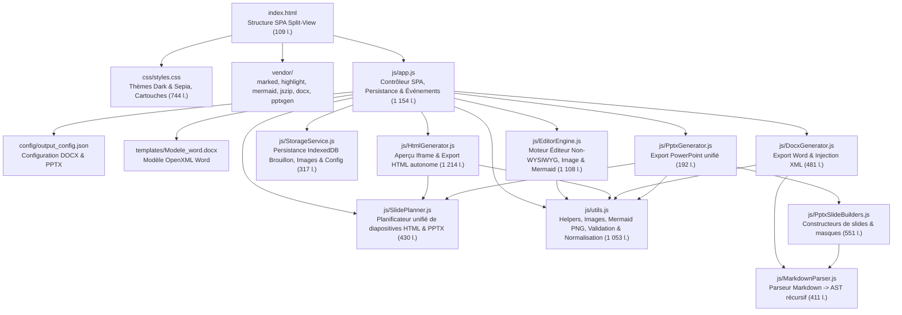

# Rapport d'Analyse — md2print

> Généré le 1er novembre 2026 — Version 1.3.0 (réf. [`docs/CHANGELOG.md`](file:///g:/devapps/md2print/docs/CHANGELOG.md))

## 1. Fiche d'Identité

| Propriété | Valeur |
|-----------|--------|
| **Type** | Webapp SPA (Single Page Application) 100 % client-side et hors-ligne |
| **Stack** | HTML5, CSS3 Vanilla (Variables CSS), JavaScript ES6+ (ES Modules natifs), IndexedDB |
| **Version** | `1.3.0` ([`docs/CHANGELOG.md`](file:///g:/devapps/md2print/docs/CHANGELOG.md), [`docs/PROJECT_KNOWLEDGE.md`](file:///g:/devapps/md2print/docs/PROJECT_KNOWLEDGE.md)) |
| **Taille estimée** | 10 modules JS (**6 911 lignes** / 215,7 Ko) + 1 fichier CSS (**744 lignes** / 15,4 Ko) + [`index.html`](file:///g:/devapps/md2print/index.html) (**109 lignes** / 4,8 Ko) |
| **Build system** | Non — exécution directe via serveur HTTP statique local (`<script type="module">`) |
| **Tests** | Non — aucun framework automatisé (validation manuelle conformément à [`.agents/rules/ui-guidelines.md`](file:///g:/devapps/md2print/.agents/rules/ui-guidelines.md)) |
| **Persistance** | `IndexedDB` (`md2print_db` via [`js/StorageService.js`](file:///g:/devapps/md2print/js/StorageService.js)) + singleton `state` en mémoire + sauvegarde par téléchargement `.md` (`Blob`) |
| **Point d'entrée** | [`index.html`](file:///g:/devapps/md2print/index.html#L107) → [`js/app.js`](file:///g:/devapps/md2print/js/app.js) |

---

## 2. Architecture

### Diagramme

### Description des couches

1. **Couche Présentation ([`index.html`](file:///g:/devapps/md2print/index.html) + [`css/styles.css`](file:///g:/devapps/md2print/css/styles.css))**
   - **Responsabilité** : Structure visuelle Split-View (50 % éditeur à gauche / 50 % aperçu `iframe` à droite, redimensionnable de 20 % à 80 % et mémorisé), barre d'outils supérieure 100 % textuelle (zéro icône, zéro émoji), système de thèmes Sombre (`data-theme="dark"`) et Clair Sépia (`data-theme="sepia"`), styles des composants `.image-cartouche` et `.mermaid-cartouche` (modes replié/déplié avec toggle `▼`/`▲`).
   - **Fichiers clés** : [`index.html`](file:///g:/devapps/md2print/index.html), [`css/styles.css`](file:///g:/devapps/md2print/css/styles.css).

2. **Couche Orchestration & Persistance ([`js/app.js`](file:///g:/devapps/md2print/js/app.js) + [`js/StorageService.js`](file:///g:/devapps/md2print/js/StorageService.js))**
   - **Responsabilité** :
     - Gestion de l'état global singleton `state` et du cache DOM `dom`.
     - Persistance transactionnelle dans `IndexedDB` (`md2print_db`, stores `app_state` et `local_images`) du brouillon courant, des images Base64, des préférences d'interface (`theme`, `viewport`, `editorWidthPct`) et des fichiers `output_config.json` et `Modele_word.docx` personnalisés.
     - Raccourcis clavier (`Ctrl+S` pour enregistrer, `Ctrl+M` pour insérer un diagramme Mermaid).
     - Rafraîchissement de l'aperçu `iframe` avec `debounce` de `120 ms` lors de la frappe et synchronisation bidirectionnelle du défilement en mode `report`.
   - **Dépendances** : [`js/EditorEngine.js`](file:///g:/devapps/md2print/js/EditorEngine.js), [`js/SlidePlanner.js`](file:///g:/devapps/md2print/js/SlidePlanner.js), [`js/StorageService.js`](file:///g:/devapps/md2print/js/StorageService.js), [`js/utils.js`](file:///g:/devapps/md2print/js/utils.js), [`js/HtmlGenerator.js`](file:///g:/devapps/md2print/js/HtmlGenerator.js), [`js/DocxGenerator.js`](file:///g:/devapps/md2print/js/DocxGenerator.js), [`js/PptxGenerator.js`](file:///g:/devapps/md2print/js/PptxGenerator.js).

3. **Couche Moteur d'Édition Non-WYSIWYG ([`js/EditorEngine.js`](file:///g:/devapps/md2print/js/EditorEngine.js))**
   - **Responsabilité** :
     - Maintien de l'invariant `1 caractère = 1 unité`, `1 cartouche = 1 unité` et `sentinelle = 0 unité`.
     - Cartouches `.image-cartouche` (hauteur 2 lignes) et `.mermaid-cartouche` vert interactif (replié par défaut avec flèche toggle `▼`/`▲`, zone de texte `<textarea>` éditable en mode déplié).
     - Formatage syntaxique en direct sans masquer les délimiteurs Markdown : titres `#` à `#####`, styles inline, blocs de code, citations, séparateurs `---`, listes décalées de `5ch` par niveau, et alignement automatique des colonnes de tableaux en grille CSS avec repli automatique (`max-width: 60ch`).

4. **Couche Planification de Diapositives ([`js/SlidePlanner.js`](file:///g:/devapps/md2print/js/SlidePlanner.js))**
   - **Responsabilité** :
     - Moteur commun de segmentation et de pagination pour la vue Diaporama HTML et l'export PowerPoint (`.pptx`).
     - Application uniforme des règles de découpage : diapositives de couverture (`#`), sections/chapitres (`##`), sous-titres (`###`), calcul de débordement vertical selon les dimensions du masque (`area.y + area.h`), et création systématique d'une nouvelle diapositive lors de la rencontre d'un séparateur horizontal `---`.

5. **Couche Utilitaires, Diagrammes & Rastérisation ([`js/utils.js`](file:///g:/devapps/md2print/js/utils.js))**
   - **Responsabilité** :
     - Lecture de fichiers, téléchargement `Blob`, normalisation Markdown, validation structurelle JSON.
     - Gestion des diagrammes Mermaid : rendu SVG asynchrone côté client (`renderMermaidBlocksMap`), rastérisation en PNG 2x haute résolution via `<canvas>` (`renderMermaidToPngDataUrl`), conversion des balises `foreignObject` en `<text>`/`<tspan>` SVG pour assurer la compatibilité avec `canvas.drawImage`.
     - Conversion SVG/WebP en PNG pour Office, conversion et purge des images Base64 orphelines.

6. **Couche Parsing AST & Moteurs d'Export**
   - **AST ([`js/MarkdownParser.js`](file:///g:/devapps/md2print/js/MarkdownParser.js))** : Parseur de blocs `parseToAST()` avec préservation de la chaîne `raw` et analyseur récursif de styles inline `extractInlineStyles()`.
   - **HTML ([`js/HtmlGenerator.js`](file:///g:/devapps/md2print/js/HtmlGenerator.js))** : Génère un document HTML5 autonome avec thème Azur, schémas Mermaid vectoriels dans des conteneurs ombrés, sommaire repliable, ScrollSpy, et mode Diaporama alimenté par `SlidePlanner`.
   - **Word ([`js/DocxGenerator.js`](file:///g:/devapps/md2print/js/DocxGenerator.js))** : Génère le document `.docx` avec intégration des schémas Mermaid convertis en images haute définition, injection dans `Modele_word.docx` via `JSZip`.
   - **PowerPoint ([`js/PptxGenerator.js`](file:///g:/devapps/md2print/js/PptxGenerator.js) & [`js/PptxSlideBuilders.js`](file:///g:/devapps/md2print/js/PptxSlideBuilders.js))** : Génère la présentation `.pptx` pilotée par `SlidePlanner` avec rendu fidèle des diapositives, masques de contenu et diagrammes Mermaid intégrés.
