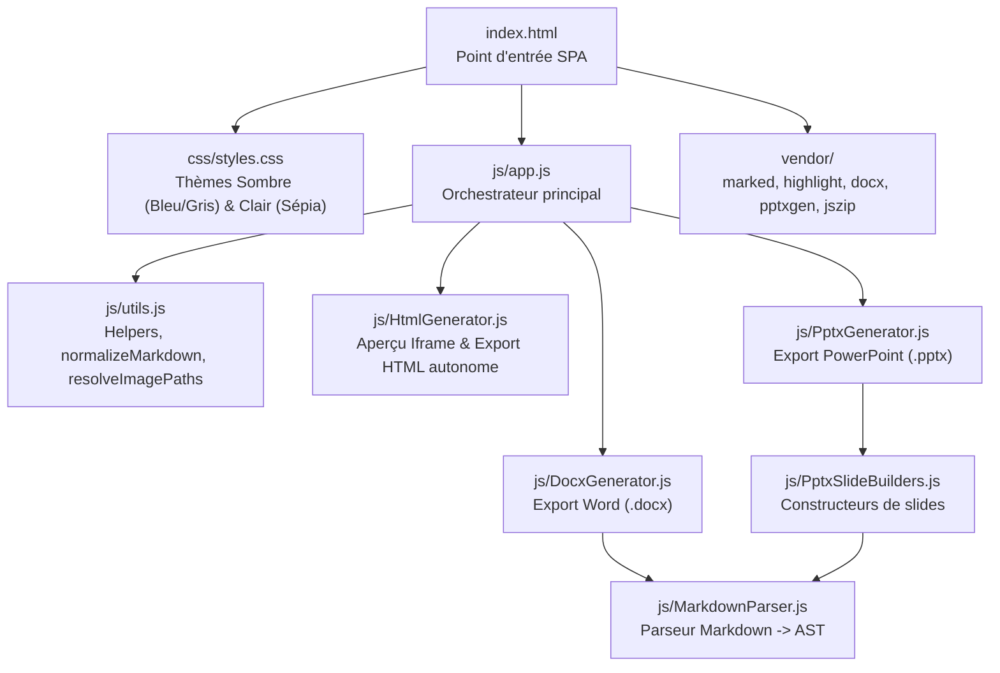

# Rapport d'Analyse — md2print

> Version 1.0.0 — Mise à jour le 25 octobre 2026

## 1. Fiche d'Identité

| Propriété | Valeur |
|---|---|
| **Type** | Webapp SPA (Single Page Application) |
| **Stack** | HTML5, CSS3 (Vanilla), JavaScript ES6+ (Modules ES) |
| **Version** | 1.0.0 (documentée dans [`docs/CHANGELOG.md`](file:///g:/devapps/md2print/docs/CHANGELOG.md)) |
| **Taille** | 9 fichiers source principaux (`index.html`, `css/styles.css`, 7 modules dans `js/`) |
| **Build system** | Non — exécution directe via serveur HTTP local |
| **Persistance** | En mémoire dans l'objet `state` + sauvegarde par téléchargement `.md` |
| **Point d'entrée** | [`index.html`](file:///g:/devapps/md2print/index.html) → charge [`js/app.js`](file:///g:/devapps/md2print/js/app.js) |

## 2. Architecture

### Diagramme

### Description des couches

- **Couche Présentation ([`index.html`](file:///g:/devapps/md2print/index.html) + [`css/styles.css`](file:///g:/devapps/md2print/css/styles.css))** :
  - Interface Split-View (50 % gauche / 50 % droite par défaut) avec séparateur central redimensionnable.
  - Barre de menu supérieure 100 % textuelle (zéro émoji, zéro icône).
  - Thèmes Sombre (`data-theme="dark"`) et Clair Sépia (`data-theme="sepia"`).
- **Couche Orchestration ([`js/app.js`](file:///g:/devapps/md2print/js/app.js))** :
  - Singleton `state`, cache DOM `dom`, gestion des fichiers/dossiers `.md`, glisser-déposer et collage d'images Base64, synchronisation du défilement gauche/droite, déclenchement des exports.
- **Couche Parsing & Génération (`js/`)** :
  - [`js/utils.js`](file:///g:/devapps/md2print/js/utils.js) : Normalisation des tableaux Markdown, résolution des images Base64, lecture/écriture de fichiers.
  - [`js/MarkdownParser.js`](file:///g:/devapps/md2print/js/MarkdownParser.js) : Construction de l'AST Markdown (titres, listes, tableaux, code, citations, images).
  - [`js/HtmlGenerator.js`](file:///g:/devapps/md2print/js/HtmlGenerator.js) : Génération du document `.html` autonome avec sommaire repliable et modes Rapport/Slide.
  - [`js/DocxGenerator.js`](file:///g:/devapps/md2print/js/DocxGenerator.js) : Génération `.docx` et injection XML dans `Modele_word.docx`.
  - [`js/PptxGenerator.js`](file:///g:/devapps/md2print/js/PptxGenerator.js) & [`js/PptxSlideBuilders.js`](file:///g:/devapps/md2print/js/PptxSlideBuilders.js) : Génération `.pptx` selon `output_config.json`.

## 3. Conventions du Projet

| Aspect | Convention |
|---|---|
| **Nommage variables & fonctions** | `camelCase` strict |
| **Modules** | Modules ES6 natifs (`import` / `export`) |
| **Commentaires** | JSDoc complète (`@param`, `@returns`) en français sur toutes les fonctions |
| **CSS** | Variables CSS (`:root`, `[data-theme="dark"]`, `[data-theme="sepia"]`), nomenclature descriptive |
| **Politique UI** | Zéro icône, zéro émoji (interface sobre et textuelle) |
| **Politique de tests** | Aucun serveur ni test automatisé lancé par les agents ; validation manuelle par le développeur |

## 4. Score de Maintenabilité

| Critère | Score | Justification |
|---|---|---|
| Lisibilité | 5/5 | Découpage clair en 7 modules ES6 spécialisés, nommage explicite. |
| Séparation des responsabilités | 5/5 | UI/Orchestration (`app.js`), utilitaires (`utils.js`), AST (`MarkdownParser.js`) et chaque moteur d'export (`HtmlGenerator.js`, `DocxGenerator.js`, `PptxGenerator.js`) sont isolés. |
| Cohérence des conventions | 5/5 | Respect strict des règles ES6+, CSS moderne et politique zéro icône/émoji. |
| Documentation | 5/5 | JSDoc sur toutes les fonctions, cahier des charges, changelog et documentation d'architecture à jour. |
