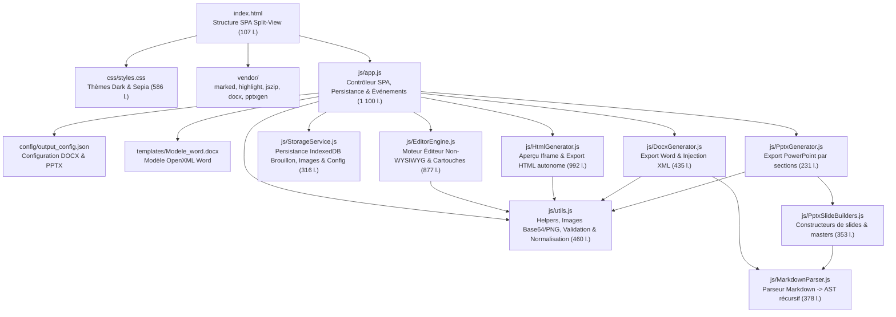
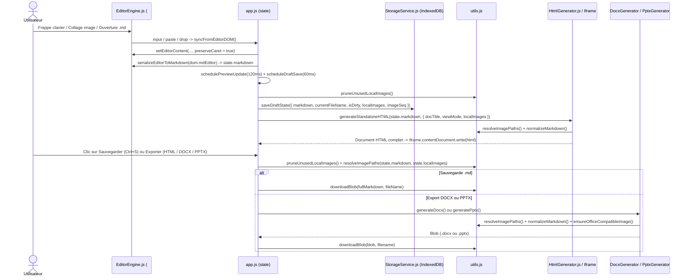

# Rapport d'Analyse — md2print

> Généré le 31 octobre 2026 — Version 1.2.0 (réf. [`docs/CHANGELOG.md`](file:///g:/devapps/md2print/docs/CHANGELOG.md))

## 1. Fiche d'Identité

| Propriété | Valeur |
|-----------|--------|
| **Type** | Webapp SPA (Single Page Application) 100 % client-side et hors-ligne |
| **Stack** | HTML5, CSS3 Vanilla (Variables CSS), JavaScript ES6+ (ES Modules natifs), IndexedDB |
| **Version** | `1.2.0` ([`docs/CHANGELOG.md`](file:///g:/devapps/md2print/docs/CHANGELOG.md), [`docs/PROJECT_KNOWLEDGE.md`](file:///g:/devapps/md2print/docs/PROJECT_KNOWLEDGE.md)) |
| **Taille estimée** | 9 modules JS (**5 141 lignes** / 163,4 Ko) + 1 fichier CSS (**586 lignes** / 12,1 Ko) + [`index.html`](file:///g:/devapps/md2print/index.html) (**107 lignes**) |
| **Build system** | Non — exécution directe via serveur HTTP statique local (`<script type="module">`) |
| **Tests** | Non — aucun framework automatisé (validation manuelle conformément à [`.agents/rules/ui-guidelines.md`](file:///g:/devapps/md2print/.agents/rules/ui-guidelines.md)) |
| **Persistance** | `IndexedDB` (`md2print_db` via [`js/StorageService.js`](file:///g:/devapps/md2print/js/StorageService.js)) + singleton `state` en mémoire + sauvegarde par téléchargement `.md` (`Blob`) |
| **Point d'entrée** | [`index.html`](file:///g:/devapps/md2print/index.html#L105) → [`js/app.js`](file:///g:/devapps/md2print/js/app.js) |

---

## 2. Architecture

### Diagramme

### Description des couches

1. **Couche Présentation ([`index.html`](file:///g:/devapps/md2print/index.html) + [`css/styles.css`](file:///g:/devapps/md2print/css/styles.css))**
   - **Responsabilité** : Structure visuelle Split-View (50 % éditeur à gauche / 50 % aperçu `iframe` à droite, redimensionnable de 20 % à 80 % et mémorisé), barre d'outils supérieure 100 % textuelle (zéro icône, zéro émoji), système de thèmes Sombre (`data-theme="dark"`) et Clair Sépia (`data-theme="sepia"`).
   - **Fichiers clés** : [`index.html`](file:///g:/devapps/md2print/index.html#L18-L102), [`css/styles.css`](file:///g:/devapps/md2print/css/styles.css#L7-L586).

2. **Couche Orchestration & Persistance ([`js/app.js`](file:///g:/devapps/md2print/js/app.js) + [`js/StorageService.js`](file:///g:/devapps/md2print/js/StorageService.js))**
   - **Responsabilité** :
     - Gestion de l'état global singleton [`state`](file:///g:/devapps/md2print/js/app.js#L43-L58) et du cache DOM [`dom`](file:///g:/devapps/md2print/js/app.js#L61-L103).
     - Persistance transactionnelle dans `IndexedDB` (`md2print_db`, stores `app_state` et `local_images`) du brouillon courant, des images Base64, des préférences d'interface (`theme`, `viewport`, `editorWidthPct`) et des fichiers `output_config.json` et `Modele_word.docx` personnalisés via [`restoreFromStorage()`](file:///g:/devapps/md2print/js/app.js#L220-L286), [`persistDraftNow()`](file:///g:/devapps/md2print/js/app.js#L168-L185) et [`savePreferencesToStorage()`](file:///g:/devapps/md2print/js/app.js#L140-L150).
     - Chargement initial par `fetch()` de [`config/output_config.json`](file:///g:/devapps/md2print/config/output_config.json) et [`templates/Modele_word.docx`](file:///g:/devapps/md2print/templates/Modele_word.docx) via [`loadDefaultConfigAndTemplate()`](file:///g:/devapps/md2print/js/app.js#L292-L315) et réinitialisation via [`handleResetConfig()`](file:///g:/devapps/md2print/js/app.js#L612-L624).
     - Rafraîchissement de l'aperçu `iframe` avec `debounce` de `120 ms` lors de la frappe ([`schedulePreviewUpdate()`](file:///g:/devapps/md2print/js/app.js#L868-L874)) et synchronisation bidirectionnelle du défilement en mode `report`.
   - **Dépendances** : [`js/EditorEngine.js`](file:///g:/devapps/md2print/js/EditorEngine.js), [`js/StorageService.js`](file:///g:/devapps/md2print/js/StorageService.js), [`js/utils.js`](file:///g:/devapps/md2print/js/utils.js), [`js/HtmlGenerator.js`](file:///g:/devapps/md2print/js/HtmlGenerator.js), [`js/DocxGenerator.js`](file:///g:/devapps/md2print/js/DocxGenerator.js), [`js/PptxGenerator.js`](file:///g:/devapps/md2print/js/PptxGenerator.js).

3. **Couche Moteur d'Édition Non-WYSIWYG ([`js/EditorEngine.js`](file:///g:/devapps/md2print/js/EditorEngine.js))**
   - **Responsabilité** :
     - Maintien de l'invariant `1 caractère = 1 unité`, `1 cartouche .image-cartouche = 1 unité` et `sentinelle   = 0 unité` ([`getNodeUnitLength()`](file:///g:/devapps/md2print/js/EditorEngine.js#L69-L83), [`getEditorSelectionOffsets()`](file:///g:/devapps/md2print/js/EditorEngine.js#L144-L157), [`restoreEditorSelectionOffsets()`](file:///g:/devapps/md2print/js/EditorEngine.js#L232-L247)).
     - Formatage syntaxique en direct sans masquer les délimiteurs ([`buildFormattedTextNodes()`](file:///g:/devapps/md2print/js/EditorEngine.js#L264-L369), [`setEditorContent()`](file:///g:/devapps/md2print/js/EditorEngine.js#L533-L702)) : titres `#` à `#####`, gras, souligné, italique, barré, code inline, liens, blocs de code, citations, listes décalées de `5ch` par niveau, alignement des colonnes de tableaux en grille CSS ([`buildTableBlockRowSpans()`](file:///g:/devapps/md2print/js/EditorEngine.js#L423-L494)) et objets graphiques `.image-cartouche` sur 2 lignes de hauteur.

4. **Couche Utilitaires, Normalisation & Validation ([`js/utils.js`](file:///g:/devapps/md2print/js/utils.js))**
   - **Responsabilité** : Lecture de fichiers (`FileReader`), téléchargement `Blob`, transformation des images Base64 en jetons `[image : alt (img-X)]` ([`collapseBase64ToCartouches`](file:///g:/devapps/md2print/js/utils.js#L177-L187)), réinjection Base64 ([`resolveImagePaths`](file:///g:/devapps/md2print/js/utils.js#L196-L231)), conversion automatique `.svg`/`.webp` vers `image/png` via `<canvas>` ([`ensureOfficeCompatibleImage`](file:///g:/devapps/md2print/js/utils.js#L418-L459)), purge des images Base64 orphelines ([`pruneUnusedLocalImages`](file:///g:/devapps/md2print/js/utils.js#L390-L411)), réparation automatique des tableaux Markdown ([`normalizeMarkdown`](file:///g:/devapps/md2print/js/utils.js#L238-L346)) et validation structurelle de `output_config.json` ([`validateOutputConfig`](file:///g:/devapps/md2print/js/utils.js#L353-L381)).

5. **Couche Parsing AST & Moteurs d'Export**
   - **AST ([`js/MarkdownParser.js`](file:///g:/devapps/md2print/js/MarkdownParser.js))** : Parseur de blocs [`parseToAST()`](file:///g:/devapps/md2print/js/MarkdownParser.js#L195-L373) et analyseur récursif de styles inline [`extractInlineStyles()`](file:///g:/devapps/md2print/js/MarkdownParser.js#L30-L136) prenant en charge l'imbrication (`**gras et *italique***`, `***gras+italique***`, `__souligné__`, `<u>souligné</u>`, `~~barré~~`, `` `code` ``, `[libellé](url)`).
   - **HTML ([`js/HtmlGenerator.js`](file:///g:/devapps/md2print/js/HtmlGenerator.js))** : Génère via [`generateStandaloneHTML()`](file:///g:/devapps/md2print/js/HtmlGenerator.js#L168-L992) un document HTML5 autonome (thème Azur, sommaire repliable `H1`-`H3`, `ScrollSpy`, modes Rapport et Slide).
   - **Word ([`js/DocxGenerator.js`](file:///g:/devapps/md2print/js/DocxGenerator.js))** : Génère le `.docx` via `window.docx` (titres, paragraphes, blocs de code, citations, séparateurs, tableaux, images) et l'injecte dans `Modele_word.docx` via `window.JSZip` ([`injectIntoTemplate()`](file:///g:/devapps/md2print/js/DocxGenerator.js#L311-L374)).
   - **PowerPoint ([`js/PptxGenerator.js`](file:///g:/devapps/md2print/js/PptxGenerator.js) & [`js/PptxSlideBuilders.js`](file:///g:/devapps/md2print/js/PptxSlideBuilders.js))** : Découpe le Markdown par sections `##` et construit les diapositives selon les masques de `output_config.json`.

---

## 3. Flux de Données

---

## 4. Conventions du Projet

> [!IMPORTANT]
> Respecter ces conventions ainsi que les règles de `.agents/rules/` pour toute future intervention.

| Aspect | Convention |
|--------|-----------|
| **Nommage variables & fonctions** | `camelCase` strict (`state`, `initDomRefs`, `serializeEditorToMarkdown`), constantes figées en `UPPER_SNAKE_CASE` (`DEFAULT_FORMAT`, `DB_NAME`, `STORE_STATE`) |
| **Nommage fichiers** | `PascalCase.js` pour les moteurs et services spécialisés (`EditorEngine.js`, `StorageService.js`, `DocxGenerator.js`, `MarkdownParser.js`), `camelCase.js` pour l'orchestrateur et les utilitaires (`app.js`, `utils.js`) |
| **Modules** | ES Modules natifs (`import { ... } from './...'` / `export`) sans bundler |
| **Exports** | Named exports exclusivement (`export const`, `export function`, `export async function`) |
| **Async** | `async/await` systématique avec `Promise` encapsulant `IndexedDB`, `FileReader` et `Image.onload`, plus [`yieldToMain()`](file:///g:/devapps/md2print/js/utils.js#L104) pour ne pas bloquer l'UI |
| **Erreurs** | `try/catch` avec notification utilisateur via [`showToast(msg, 'error')`](file:///g:/devapps/md2print/js/app.js#L1085-L1100) dans l'UI |
| **Commentaires** | JSDoc complète en français (`@param`, `@returns`) au-dessus de chaque fonction |
| **CSS** | Variables CSS thématiques (`:root`, `[data-theme="dark"]`, `[data-theme="sepia"]`), Flexbox/Grid, nomenclature descriptive et variantes BEM (`.toast--error`, `.toast--success`) |
| **Politique UI** | **Zéro icône, zéro émoji** dans toute l'interface et les documents générés ([`.agents/rules/ui-guidelines.md`](file:///g:/devapps/md2print/.agents/rules/ui-guidelines.md)) |

### Patterns Architecturaux Identifiés

- **Singleton d'état centralisé avec persistance transactionnelle `IndexedDB`** : Objet `state` dans [`js/app.js`](file:///g:/devapps/md2print/js/app.js#L43-L58) synchronisé avec la base `IndexedDB` `md2print_db` ([`js/StorageService.js`](file:///g:/devapps/md2print/js/StorageService.js)) contenant un store clé-valeur `app_state` et un store dédié `local_images` pour supporter plusieurs dizaines de Mo d'images Base64 sans limite de 5 Mo.
- **Invariant d'unités de sélection DOM (`contenteditable`)** : Dans [`js/EditorEngine.js`](file:///g:/devapps/md2print/js/EditorEngine.js#L69-L247), chaque caractère texte ou ` ` vaut `1` unité, chaque `` vaut `1` unité, et la sentinelle ` ` vaut `0` unité.
- **Substitution de jeton et Garbage Collection (`localImages`)** : Les chaînes Base64 sont remplacées dans l'éditeur par `[image : alt (img-X)]` ([`collapseBase64ToCartouches`](file:///g:/devapps/md2print/js/utils.js#L177-L187)) et les entrées `img-X` supprimées sont purgées automatiquement via [`pruneUnusedLocalImages()`](file:///g:/devapps/md2print/js/utils.js#L390-L411).
- **Debounce de rendu Iframe** : [`schedulePreviewUpdate(120)`](file:///g:/devapps/md2print/js/app.js#L868-L874) découple le formatage immédiat de `#mdEditor` de la réécriture complète de l'`iframe`.

---

## 5. Dépendances Clés

Toutes les bibliothèques tierces sont **vendored** dans `vendor/` et chargées globalement via `<script>` dans [`index.html`](file:///g:/devapps/md2print/index.html#L11-L15) pour garantir un fonctionnement 100 % hors-ligne :

| Dépendance | Fichier | Variable Globale | Rôle | Type |
|-----------|---------|------------------|------|------|
| **Marked.js** | `vendor/marked.min.js` (39,9 Ko) | `window.marked` | Parsing Markdown GFM vers HTML avec renderers personnalisés dans [`HtmlGenerator.js`](file:///g:/devapps/md2print/js/HtmlGenerator.js#L51-L157) | Vendored |
| **Highlight.js** | `vendor/highlight.min.js` (121,7 Ko) | `window.hljs` | Coloration syntaxique des blocs de code dans l'aperçu et l'export HTML | Vendored |
| **JSZip** | `vendor/jszip.min.js` (97,6 Ko) | `window.JSZip` | Ouverture, modification XML/médias et recompression du modèle OpenXML `.docx` | Vendored |
| **docx** | `vendor/docx.umd.js` (808,2 Ko) | `window.docx` | Génération orientée objet des paragraphes, tableaux et `ImageRun` Word | Vendored |
| **PptxGenJS** | `vendor/pptxgen.bundle.js` (460,9 Ko) | `window.PptxGenJS` | Génération de présentations PowerPoint `.pptx` (formes, textes, tableaux, images) | Vendored |

---

## 6. Points d'Attention

> [!WARNING]
> Zones de vigilance à garder à l'esprit lors des évolutions futures.

### Dette Technique
- Aucun marqueur `TODO`, `FIXME`, `HACK` ou `console.log` n'est présent dans le code source actif (`js/`, `css/`, `index.html`).
- Le dossier `référence/` (contenant les anciens projets `md2html` et `md2office`) reste présent à titre d'archive : **ne jamais importer ni modifier les fichiers de `référence/`**.

### Zones Sensibles
1. **Invariant de sélection dans [`js/EditorEngine.js`](file:///g:/devapps/md2print/js/EditorEngine.js#L69-L247)** :
   - Toute évolution de [`setEditorContent()`](file:///g:/devapps/md2print/js/EditorEngine.js#L533-L702) ou [`buildFormattedTextNodes()`](file:///g:/devapps/md2print/js/EditorEngine.js#L264-L369) doit conserver le nombre exact de caractères du texte Markdown source afin que [`getEditorSelectionOffsets()`](file:///g:/devapps/md2print/js/EditorEngine.js#L144-L157) et [`restoreEditorSelectionOffsets()`](file:///g:/devapps/md2print/js/EditorEngine.js#L232-L247) restent exacts au caractère près.
2. **Cohérence entre les 3 moteurs Markdown** :
   - Les règles inline et de blocs sont alignées entre [`EditorEngine.js`](file:///g:/devapps/md2print/js/EditorEngine.js#L264-L369), [`HtmlGenerator.js`](file:///g:/devapps/md2print/js/HtmlGenerator.js#L51-L157) et [`MarkdownParser.js`](file:///g:/devapps/md2print/js/MarkdownParser.js#L30-L136) ; toute nouvelle balise Markdown doit être ajoutée dans ces trois modules.

---

## 7. Score de Maintenabilité

| Critère | Score | Justification |
|---------|-------|---------------|
| **Lisibilité** | 5/5 | Code moderne ES6+, nommage explicite, fonctions bien découpées et JSDoc complète en français. |
| **Séparation des responsabilités** | 5/5 | Orchestration (`app.js`), moteur d'éditeur (`EditorEngine.js`), persistance (`StorageService.js`), utilitaires (`utils.js`), parseur AST (`MarkdownParser.js`) et moteurs d'export (`HtmlGenerator.js`, `DocxGenerator.js`, `PptxGenerator.js`) sont chacun isolés dans leur module. |
| **Cohérence des conventions** | 5/5 | Respect intégral des règles ES6+, CSS variables et de la politique zéro icône / zéro émoji. |
| **Documentation** | 5/5 | Documentation complète et synchronisée (`CAHIER_DES_CHARGES.md`, `PROJECT_KNOWLEDGE.md`, `CHANGELOG.md`, `codebase_analysis.md`, JSDoc sur 100 % des fonctions). |
| **Testabilité** | 4/5 | Les fonctions de `utils.js`, `MarkdownParser.js`, `StorageService.js` et `EditorEngine.js` sont découplées de l'état global et paramétrées explicitement (validation manuelle selon la politique du projet). |
| **Extensibilité** | 5/5 | Architecture modulaire prête pour l'ajout de nouveaux formats d'export ou de nouveaux thèmes CSS. |

---

## 8. Guide d'Intervention Rapide

### Pour ajouter une feature
1. **Nouvelle syntaxe Markdown** :
   - Mettre à jour la colorisation non-WYSIWYG dans [`js/EditorEngine.js`](file:///g:/devapps/md2print/js/EditorEngine.js) ([`buildFormattedTextNodes`](file:///g:/devapps/md2print/js/EditorEngine.js#L264-L369) ou [`setEditorContent`](file:///g:/devapps/md2print/js/EditorEngine.js#L533-L702)) **en respectant strictement l'invariant `1 caractère = 1 unité`**.
   - Mettre à jour le renderer Marked.js dans [`js/HtmlGenerator.js`](file:///g:/devapps/md2print/js/HtmlGenerator.js#L51-L157).
   - Mettre à jour [`extractInlineStyles`](file:///g:/devapps/md2print/js/MarkdownParser.js#L30-L136) ou [`parseToAST`](file:///g:/devapps/md2print/js/MarkdownParser.js#L195-L373) dans [`js/MarkdownParser.js`](file:///g:/devapps/md2print/js/MarkdownParser.js).
2. **Nouveau moteur d'export** :
   - Créer `js/MonFormatGenerator.js` sur le modèle de [`js/DocxGenerator.js`](file:///g:/devapps/md2print/js/DocxGenerator.js) (appeler `resolveImagePaths` puis `normalizeMarkdown` en entrée).
   - Ajouter le bouton dans `#dropdownExport` de [`index.html`](file:///g:/devapps/md2print/index.html#L64-L72), référencer l'élément dans [`initDomRefs()`](file:///g:/devapps/md2print/js/app.js#L67-L103) et attacher l'écouteur dans [`initEventListeners()`](file:///g:/devapps/md2print/js/app.js#L698-L701).

### Pour corriger un bug
1. **Bug de curseur ou de saisie dans l'éditeur** :
   - Inspecter [`js/EditorEngine.js`](file:///g:/devapps/md2print/js/EditorEngine.js) (`serializeEditorToMarkdown`, `getNodeUnitLength`, `getPointOffset`, `findDomPosition`, `ensureTrailingSentinel`).
2. **Bug de rendu sur les tableaux ou images** :
   - Vérifier [`resolveImagePaths()`](file:///g:/devapps/md2print/js/utils.js#L196-L231), [`ensureOfficeCompatibleImage()`](file:///g:/devapps/md2print/js/utils.js#L418-L459), [`pruneUnusedLocalImages()`](file:///g:/devapps/md2print/js/utils.js#L390-L411) et [`normalizeMarkdown()`](file:///g:/devapps/md2print/js/utils.js#L238-L346) dans [`js/utils.js`](file:///g:/devapps/md2print/js/utils.js).
3. **Validation** :
   - Ne lancer aucun serveur de test ([`.agents/rules/ui-guidelines.md`](file:///g:/devapps/md2print/.agents/rules/ui-guidelines.md)) ; lister les étapes de vérification manuelle pour l'utilisateur.

---

## 9. Checklist Pré-Intervention

- [ ] J'ai lu et compris l'architecture du projet (`PROJECT_KNOWLEDGE.md` & `codebase_analysis.md`)
- [ ] J'ai identifié les modules impactés par mon changement (et vérifié si les 3 pipelines Markdown `EditorEngine.js`, `HtmlGenerator.js`, `MarkdownParser.js` doivent évoluer ensemble)
- [ ] Je respecte les conventions du projet (`camelCase`, ES6+, JSDoc en français, variables CSS)
- [ ] Je respecte strictement la directive UI : **zéro icône, zéro émoji** et je ne lance aucun serveur de test
- [ ] J'ai vérifié que l'invariant de sélection de `#mdEditor` (`1 caractère = 1 unité`, `1 cartouche = 1 unité`, sentinelle `  = 0 unité`) est préservé
- [ ] Je ne touche pas au dossier `référence/` et je ne mélange pas refactoring et ajout de feature
