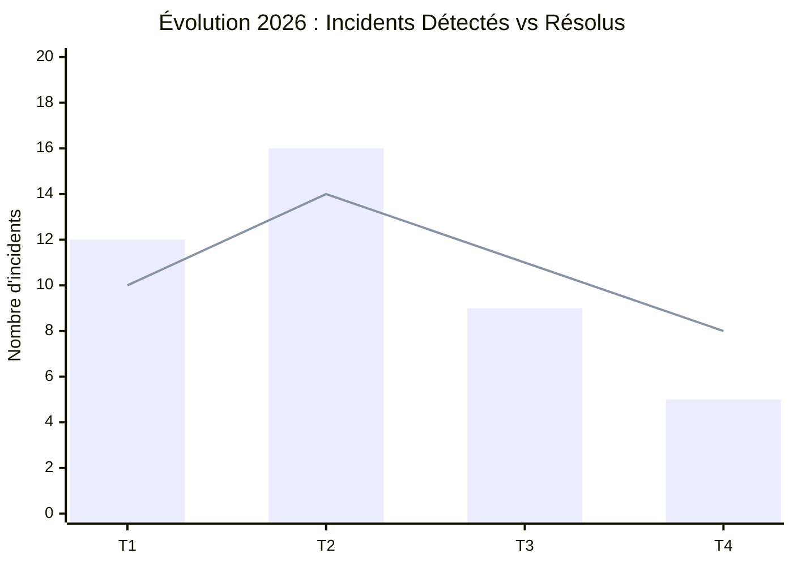

# Exemple de Transformation : Rapport Brut vers Diaporama md2print

Ce document illustre concrètement la transformation opérée par l'agent `report-to-slides` à partir d'un extrait de rapport textuel d'audit.

---

## 1. Document Brut Initial (Extrait de Rapport)

```text
Rapport d'audit de sécurité des systèmes d'information - Bilan annuel 2026
Direction des Risques et de la Conformité - Novembre 2026

1. Synthèse globale et indicateurs
Au cours de l'exercice 2026, l'ensemble des 42 serveurs critiques ont fait l'objet d'un audit approfondi. Nous avons identifié 14 vulnérabilités majeures nécessitant une remédiation urgente, ainsi que 3 incidents critiques ayant entraîné un temps d'arrêt cumulé de 18 minutes. Le taux de conformité globale aux exigences NIS2 s'établit à 94.5%, ce qui représente une progression notable par rapport aux 82% de l'an dernier.

2. Chronologie de l'incident majeur du 12 mai
L'incident majeur survenu le 12 mai a débuté à 08h15 par la détection d'une saturation anormale de la mémoire sur la base de données de production. À 08h30, l'équipe d'astreinte a procédé à la qualification du problème comme incident de sévérité 1. À 09h00, conformément à la procédure réglementaire, l'ANSSI a été notifiée par le responsable de la sécurité. À 11h45, le basculement vers le site de secours a permis le rétablissement complet des services nominaux. Enfin, le 26 mai, le rapport post-mortem détaillé a été validé et transmis au comité de direction.

3. Comparatif des scénarios d'hébergement
Pour sécuriser notre infrastructure, deux options ont été évaluées. La première option consiste en une migration complète vers le Cloud souverain SecNumCloud. Elle offre une haute disponibilité certifiée et un coût d'exploitation maîtrisé, mais impose une refonte applicative de 4 mois. La seconde option repose sur la modernisation de nos deux centres de données internes actuels. Elle garantit une maîtrise absolue des données et un calendrier court de 6 semaines, mais requiert un investissement matériel initial de 450 kEUR.

4. Recommandations prioritaires
Il est impératif d'activer l'authentification multi-facteurs (MFA) sur la totalité des comptes d'administration d'ici la fin du mois sans dérogation possible. Il est également fortement conseillé de déployer un monitoring continu des accès aux API tierces.
```

---

## 2. Diaporama Markdown Généré pour md2print

```markdown
# Audit de Sécurité des Systèmes d'Information
Bilan Annuel 2026
Direction des Risques et de la Conformité

## 01. Synthèse et Indicateurs Clés

### Indicateurs de Performance et Conformité 2026

[chiffre:42:Serveurs Audités:neutral] [chiffre:94.5%:Conformité NIS2:success] [chiffre:14:Vulnérabilités Majeures:warning] [chiffre:18 min:Temps d'Arrêt Total:danger]

[colonne:2]
#### Principaux Enseignements de l'Audit
- **Progression réglementaire** : Conformance NIS2 en hausse de 12.5 points sur un an.
- **Périmètre d'audit** : Couverture intégrale des infrastructures de production.
- **Surveillance accrue** : Renforcement nécessaire sur les accès distants et les bases secondaires.
[/colonne]

[colonne:1]
#### Statut Global
- Revue annuelle : [badge:success:Validée]
- Vulnérabilités critiques : [badge:danger:3 à traiter]
- Plan de remédiation : [badge:warning:En cours]
[/colonne]

### Évolution Trimestrielle des Incidents Détectés



## 02. Gestion des Incidents Majeurs

### Chronologie de Résolution de l'Incident du 12 Mai

[frise]
- **08h15** | **Détection** | Saturation anormale de la mémoire sur la base de données principale
- **08h30** (warning) | **Qualification** | Déclaration de sévérité 1 et mobilisation de la cellule de crise
- **09h00** (danger) | **Notification Réglementaire** | Alerte officielle transmise à l'ANSSI par le RSSI
- **11h45** (success) | **Rétablissement** | Basculement opérationnel sur le cluster de secours
- **26 mai** | **Post-Mortem** | Validation du rapport final et transmission au comité de direction
[/frise]

## 03. Analyse Stratégique d'Infrastructure

### Comparatif des Scénarios d'Hébergement

[colonne]
#### Option A : Cloud Souverain (SecNumCloud)
- **Certification** : Niveau de conformité réglementaire maximal [badge:success:Recommandé]
- **Disponibilité** : Engagement de service 99.99% multi-zones
- **Délai** : 4 mois de refonte applicative requise
- **Modèle budgétaire** : Charges d'exploitation lissées
[/colonne]

[colonne]
#### Option B : Rénovation On-Premise
- **Souveraineté** : Maîtrise interne absolue de l'ensemble des données
- **Calendrier** : Déploiement accéléré en 6 semaines
- **Investissement** : CapEx initial de 450 kEUR
- **Risque résiduel** : Obsolescence matérielle à 5 ans [badge:warning:Vigilance]
[/colonne]

## 04. Recommandations et Plan d'Action

### Mesures Prioritaires et Décisions Attendues

> [!IMPORTANT] Exigence de Sécurité Immédiate
> L'activation de l'authentification multi-facteurs (MFA) sur tous les comptes d'administration doit être achevée avant le 30 novembre, sans aucune exception de profil.

> [!TIP] Optimisation de la Détection
> Le déploiement d'une sonde de surveillance continue sur les passerelles API permettra de réduire le temps moyen de détection sous le seuil des 5 minutes.

#### Feuille de Route de Remédiation
- [x] Définition des règles de filtrage réseau renforcées
- [x] Déploiement des correctifs prioritaires sur les 42 serveurs
- [ ] Généralisation de l'authentification multi-facteurs
- [ ] Exercice de simulation de crise cyber programmé au T1 2027
```

