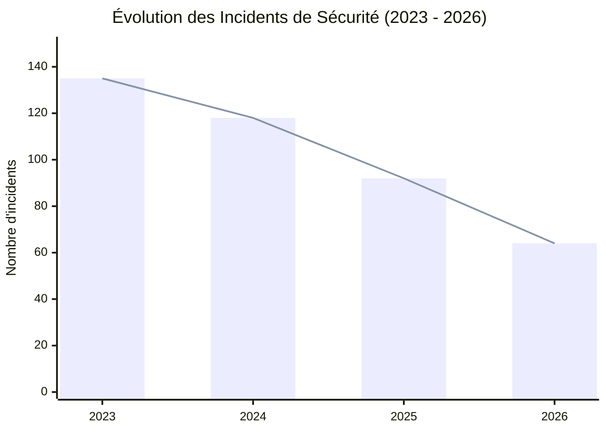
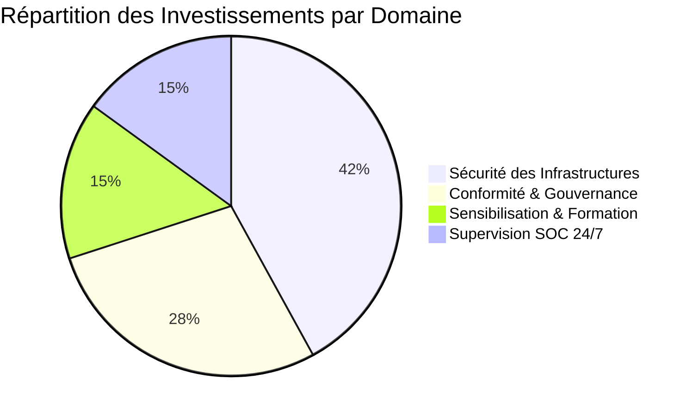
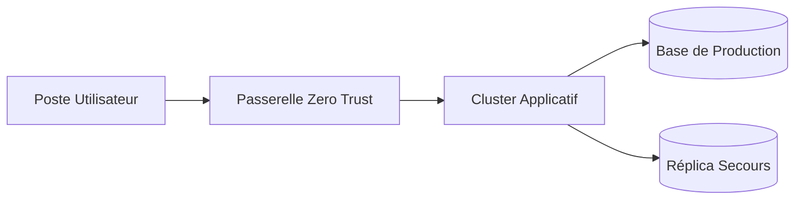
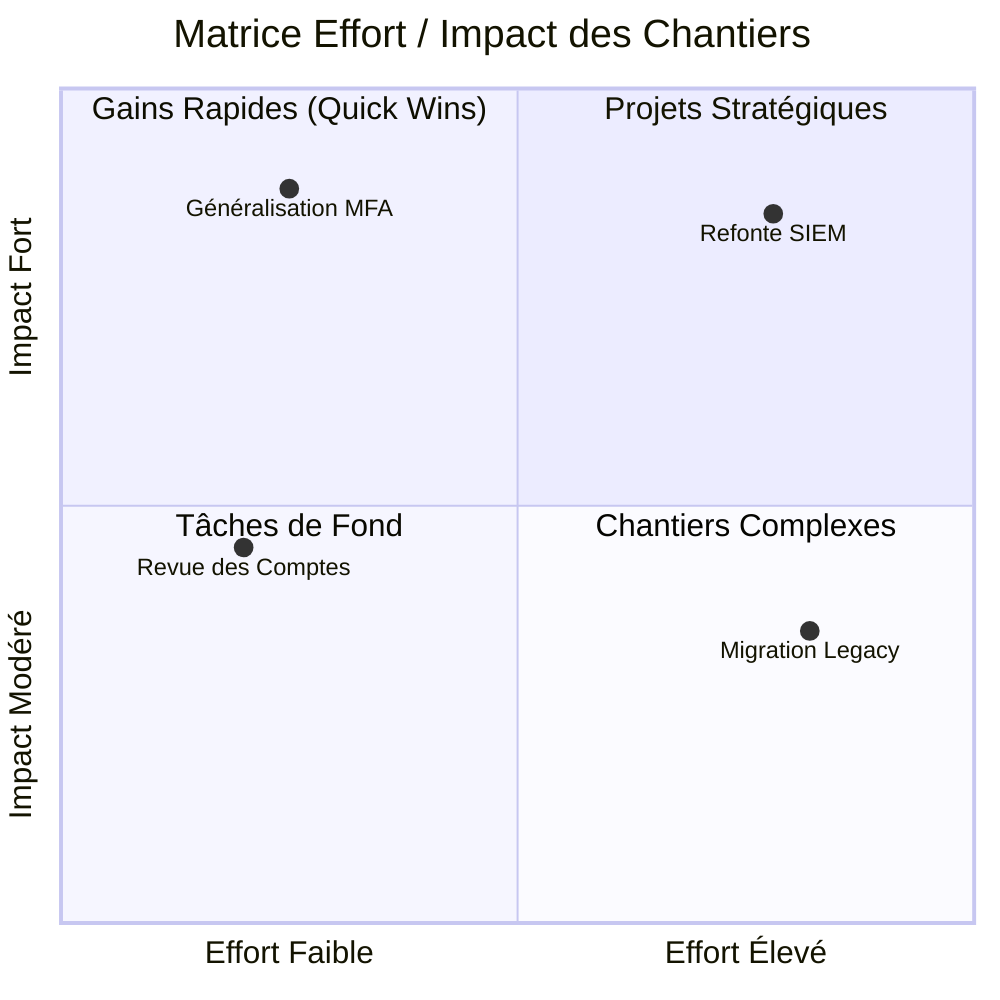

# Guide de Référence et Instructions Agent — Syntaxe Markdown md2print

Ce document constitue le référentiel syntaxique et méthodologique de **md2print**. Il est conçu pour permettre à un rédacteur ou à un **agent IA** de transformer efficacement un document source (rapport brut, compte-rendu, audit, note de cadrage, analyse technique) en un fichier Markdown enrichi, directement exploitable par md2print pour générer :
- des **présentations 16:9** (Vision Slide HTML et export PowerPoint `.pptx`),
- des **rapports paginés** (Vision Rapport HTML et export Word `.docx`).

---

## 1. Directives Fondamentales pour l'Agent de Transformation

Tout agent chargé de convertir ou d'adapter un contenu Markdown pour **md2print** doit appliquer les règles impératives suivantes :

### 1.1. Invariants Absolus
1. **Absence totale d'émojis et d'icônes décoratives** : Ne jamais insérer d'émojis, de pictogrammes Unicode ou de balises d'icônes dans les titres, sous-titres, badges, en-têtes de colonnes, listes, tableaux ou alertes. La hiérarchie visuelle repose exclusivement sur la typographie et les composants natifs de md2print (`[chiffre]`, `[colonne]`, `[frise]`, `[badge]`, `> [!...]`, Mermaid).
2. **Fidélité stricte aux données sources** : Conserver l'exactitude de tous les chiffres, pourcentages, dates, noms propres, constats et conclusions du rapport initial. Ne jamais inventer de métriques.
3. **Intégrité syntaxique des blocs** : Toute balise ouvrante (`[colonne...]`, `[frise]`, `[html]`, ```` ```mermaid ````) doit impérativement posséder sa balise fermante correspondante (`[/colonne]`, `[/frise]`, `[/html]`, ```` ``` ````) seule sur sa propre ligne.

### 1.2. Stratégie d'Adaptation selon le Format Cible

| Critère | Cible : Vision Slide (16:9 & Export PPTX) | Cible : Vision Rapport (Continu & Export DOCX) |
| :--- | :--- | :--- |
| **Granularité de lecture** | **1 diapositive (`###`) = 1 message clé**. Proscrire tout paragraphe narratif de plus de 2 lignes. | Développement analytique complet autorisé, structuré par des composants visuels de synthèse. |
| **Style rédactionnel** | Style télégraphique structuré : `- **Mot-clé directeur** : fait ou action concise`. | Paragraphes rédigés introduits ou conclus par des encadrés d'alerte, KPI et tableaux. |
| **Densité verticale maximale** | **Maximum 3 à 4 blocs ou 5 à 6 puces par diapositive `###`** pour éviter tout débordement hors du cadre 16:9. | Libre sur la hauteur de page ; utiliser des sous-titres `####` et `#####` pour aérer les sous-sections. |
| **Gestion des sujets denses** | Scinder le sujet sur plusieurs diapositives à l'aide du séparateur `---` (qui conserve automatiquement le titre `###` courant) ou réduire la taille de police interne d'une colonne via `[colonne:taille:titre:couleur:0.85]`. | Regrouper les analyses détaillées en sous-sections successives, tableaux comparatifs et colonnes côte à côte. |

---

## 2. Matrice de Décision : du Rapport Brut vers les Balises md2print

Lors de l'analyse d'un document source, l'agent doit identifier les motifs sémantiques ci-dessous et les convertir systématiquement vers le composant md2print correspondant :

| Motif détecté dans le rapport source | Composant md2print à produire | Règle d'application |
| :--- | :--- | :--- |
| **Titre général, sous-titre, auteur, date, entité** | `# Titre Principal`<br>`Sous-titre / Direction / Date` | Placé tout en haut du document. Génère la page ou diapositive de couverture. |
| **Grande partie, axe stratégique, chapitre** | `## 01. Titre du Chapitre` | Génère une diapositive d'inter-titre (Slide) ou un titre de niveau 1 (Rapport). |
| **Sujet opérationnel, constat, écran thématique** | `### Titre de la Diapositive ou Section` | Ouvre une nouvelle diapositive de contenu (bandeau supérieur en mode Slide). |
| **Suite d'un même sujet sur un second écran** | `---` | Crée une nouvelle diapositive en répétant automatiquement le dernier titre `###`. |
| **Chiffres clés, montants, pourcentages, volumes, délais** | `[chiffre:valeur:libellé:variante]` | Regrouper 2 à 4 indicateurs sur une même ligne, séparés par un espace. |
| **Comparaison (Avant/Après, Options A/B, Forces/Risques, Bilan par pôle)** | `[colonne:taille:titre:couleur:ratio]`<br>...<br>`[/colonne]` | Juxtaposer 2 ou 3 colonnes avec titre intégré et couleur sémantique (`info`, `success`, `warning`, `danger`). |
| **Chronologie, feuille de route, gestion d'incident, processus séquentiel** | `[frise]`<br>`- **Jalon** (couleur) \| **Titre** \| Texte`<br>`[/frise]` | Aligner 3 à 6 jalons chronologiques ou étapes clés. |
| **Statut, niveau de priorité, conformité, criticité** | `[badge:variante:texte]` | Insérer directement dans les listes à puces, les cellules de tableaux ou les sous-titres. |
| **Conclusion majeure, point de vigilance, prérequis, décision** | `> [!IMPORTANT]` / `> [!WARNING]` / `> [!TIP]` / `> [!CAUTION]` / `> [!NOTE]` | Encadrer les messages critiques avec un titre explicite après la balise. |
| **Séries statistiques, évolutions temporelles, comparaisons chiffrées** | ```` ```mermaid xychart-beta ... ``` ```` | Générer un graphique vectoriel en barres (`bar`) et/ou courbes (`line`). |
| **Répartition en parts ou pourcentages (total 100 %)** | ```` ```mermaid pie ... ``` ```` | Générer un diagramme circulaire avec titre. |
| **Architecture, arbre de décision, flux applicatif** | ```` ```mermaid flowchart LR ... ``` ```` | Schématiser les liens de causalité ou les composants techniques. |
| **Matrice de priorisation (Impact / Effort, Risque / Coût)** | ```` ```mermaid quadrantChart ... ``` ```` | Positionner les éléments sur une matrice 2x2. |
| **Données tabulaires multi-critères** | Tableau Markdown GFM + `[badge:...]` | Synthétiser les colonnes et qualifier la colonne de statut avec des badges. |
| **Plan d'action, suivi de livrables, recette** | `- [x] Tâche achevée`<br>`- [ ] Tâche à réaliser` | Transformer les listes d'actions en checklists visuelles. |
| **Composant interactif, jauge HTML/SVG ou animation sur mesure** | `[html]` ... `[/html]` ou ```` ```html-exec ```` | Uniquement lorsque le rendu cible est le HTML interactif (ignoré en DOCX/PPTX). |

---

## 3. Structure Documentaire et Découpage des Diapositives

En vision Diaporama (Slide 16:9) et lors de l'export PowerPoint (`.pptx`), le découpage suit cinq règles strictes :

| Balise / Niveau | Rôle en Vision Slide & PPTX | Rôle en Vision Rapport & DOCX | Exemple |
| :--- | :--- | :--- | :--- |
| `# Titre` | **Diapositive de couverture**. Les lignes de texte simples placées immédiatement dessous deviennent le sous-titre et les métadonnées (auteur, date). | **Titre principal du document** en en-tête de rapport. | `# Schéma Directeur 2026`<br>`Direction Technique — Novembre 2026` |
| `## Titre` | **Diapositive de chapitre** (inter-titre plein écran). | **Titre de grande section** (Niveau 1). | `## 01. Panorama de la Menace` |
| `### Titre` | **Diapositive de contenu**. Le titre s'affiche dans le bandeau supérieur de la slide. | **Sous-section** (Niveau 2). | `### La menace cyber sur le secteur financier` |
| `####` à `######` | **Sous-titres internes** intégrés dans le corps de la diapositive courante (aucun saut de slide). | **Sous-titres hiérarchiques** de niveaux 3 à 5. | `#### Périmètre des actifs critiques` |
| `---` | **Saut de diapositive explicite** : ouvre une nouvelle diapositive de contenu en conservant le titre du dernier `###`. | **Ligne de séparation horizontale** thématique. | `---` |

> [!IMPORTANT] Règle de continuité pour l'Agent
> Tout contenu (texte, KPI, colonne, tableau) destiné à figurer sur une diapositive de contenu doit être placé **sous un titre `###`**. Ne jamais placer de contenu analytique directement sous un `##` (qui est réservé à la diapositive intercalaire de chapitre), mais toujours ouvrir un `###` immédiatement après.

---

## 4. Disposition en Colonnes Multiples (`[colonne]`)

Les blocs `[colonne]` consécutifs sont automatiquement regroupés côte à côte sur une même rangée horizontale (`.slide-columns-row`) et se partagent la largeur disponible proportionnellement à leur taille relative.

### 4.1. Syntaxe Complète et Paramètres Positionnels

```text
[colonne:taille relative:titre:couleur:ratio police]
Contenu Markdown de la colonne...
[/colonne]
```

Les **4 paramètres situés après `colonne` sont optionnels** :

| Position | Paramètre | Valeurs acceptées | Défaut | Comportement détaillé |
| :---: | :--- | :--- | :---: | :--- |
| **1** | `taille relative` | Nombre positif (`1`, `2`, `1.5`, `3`...) | `1` | Poids flex de la colonne dans la rangée. Exemple : une colonne `2` suivie d'une colonne `1` occupera 2/3 de la largeur contre 1/3. |
| **2** | `titre` | Texte libre (sans `:`) | *(aucun)* | Génère automatiquement un en-tête de colonne centré de niveau 4 (`####`) tout en haut de la carte. En export Word et PowerPoint, ce titre est converti en sous-titre `####`. |
| **3** | `couleur` | `info`, `success`, `warning`, `danger`, `important`, `neutral` (ou `#RRGGBB`) | *(standard)* | Colore l'arrière-plan du bandeau contenant le titre avec la couleur de bordure du badge correspondant et affiche le texte du titre en **blanc**. Si omis ou vide, le bandeau conserve le fond et la couleur de texte standards de la colonne. |
| **4** | `ratio police` | Multiplicateur décimal (`0.85`, `1.15`) ou pourcentage (`85%`, `115%`) | `1` (`100%`) | Met proportionnellement à l'échelle la taille de police du **titre** et de **tout le contenu interne** de la colonne (paragraphes, listes, tableaux, citations, badges, chiffres). Idéal pour ajuster une colonne dense en mode Slide. |

*Alias de couleurs acceptés : `bleu`/`note` (`info`), `vert`/`ok`/`tip` (`success`), `orange`/`jaune`/`warn` (`warning`), `rouge`/`critique`/`error`/`urgent` (`danger`), `violet`/`purple` (`important`), `gris`/`gray`/`default` (`neutral`).*

### 4.2. Exemples de Combinaisons

```markdown
[colonne:2:Synthèse des Constats:info]
- **Couverture d'audit** : 100 % des serveurs critiques inspectés
- **Conformité DORA** : Socle documentaire validé [badge:success:Validé]
- **Continuité d'activité** : Plan de reprise testé avec succès
[/colonne]

[colonne:1:Points de Vigilance:warning:85%]
- Délai de révocation des accès prestataires supérieur à 24 h
- Renouvellement des certificats internes à automatiser
- Cloisonnement du réseau de sauvegarde à finaliser
[/colonne]
```

**Omission sélective de paramètres (en conservant les séparateurs `:`) :**
- **Titre seul (taille par défaut `1`, style standard)** :
  `[colonne::Objectifs 2027]` ou directement `[colonne:Objectifs 2027]` (si le 1er argument n'est pas un nombre, il est interprété comme le titre).
- **Titre et couleur (taille par défaut `1`)** :
  `[colonne::Risques Critiques:danger]` ou `[colonne:Risques Critiques:danger]`.
- **Titre et ratio de police (sans couleur de bandeau)** :
  `[colonne:1:Détail Technique::0.85]` ou `[colonne:Détail Technique:0.85]` (un nombre décimal avec point/virgule ou un `%` en 2e position après le titre est reconnu comme ratio de police).
- **Ratio de police seul (sans titre ni couleur)** :
  `[colonne::::85%]` ou `[colonne:1:::0.85]`.

### 4.3. Règles Critiques pour l'Agent sur les Colonnes
1. **Ne jamais dupliquer le titre** : Si le titre est déclaré dans le paramètre `[colonne:1:Mon Titre:info]`, **ne pas** réécrire `#### Mon Titre` à l'intérieur de la colonne.
2. **Éviter le caractère `:` dans le titre du paramètre** : Le caractère `:` servant de délimiteur de paramètres, utiliser un tiret ` - ` ou des parenthèses dans le titre de la balise (ex. `[colonne:1:Phase 1 - Cadrage:info]`).
3. **Séparation des rangées de colonnes** : Deux blocs `[colonne]...[/colonne]` séparés uniquement par un retour à la ligne ou une ligne vide sont placés côte à côte sur la **même rangée**. Pour forcer deux groupes de colonnes à s'empiler verticalement (deux rangées distinctes), insérer un sous-titre, un paragraphe, un callout ou encapsuler chaque rangée dans `[colonnes] ... [/colonnes]`.

---

## 5. Cartouches Métriques et Indicateurs Clés (`[chiffre]`)

Les balises `[chiffre]` génèrent des cartes d'indicateurs clés (KPI) avec valeur mise en exergue (5x), libellé en capitales et bordure supérieure colorée.

### 5.1. Syntaxe et Variantes

```text
[chiffre:valeur:libellé:variante]
```
- **Alias acceptés** : `[kpi:...]`, `[metric:...]`, `[stat:...]`
- **`valeur`** : Chiffre, montant, délai ou pourcentage court (ex. `8 257`, `17,8 %`, `+24 %`, `1,4 M€`, `< 15 min`). **Ne doit jamais contenir le caractère `:`**.
- **`libellé`** : Description synthétique de l'indicateur (ex. `Événements recensés en Europe en 2025`).
- **`variante`** *(optionnelle)* : Applique les couleurs configurées pour le type de badge correspondant (bordure supérieure et couleur du chiffre).

| Variante | Alias acceptés | Signification sémantique | Exemple |
| :--- | :--- | :--- | :--- |
| *(aucune)* / `default` | — | Couleur d'accentuation standard des métriques du thème | `[chiffre:8 257:Événements recensés en 2025]` |
| `info` | `bleu`, `note` | Indicateur informatif ou de cadrage | `[chiffre:42:Applications Auditées:info]` |
| `success` | `vert`, `ok`, `tip` | Objectif atteint, conformité, performance positive | `[chiffre:99,95 %:Disponibilité Annuelle:success]` |
| `warning` | `orange`, `jaune`, `warn` | Seuil de vigilance, dérive modérée, risque moyen | `[chiffre:128:Compromissions par rançongiciel:warning]` |
| `danger` | `rouge`, `critique`, `error`, `urgent` | Risque critique, incident majeur, dépassement | `[chiffre:17,8 %:Part des incidents critiques:danger]` |
| `important` | `violet`, `purple` | Indicateur stratégique prioritaire | `[chiffre:2,5 M€:Budget Cyber 2026:important]` |
| `neutral` | `gris`, `gray` | Donnée de référence ou historique neutre | `[chiffre:2024:Année de référence:neutral]` |

### 5.2. Alignement Horizontal des KPI
Pour afficher **2, 3 ou 4 cartouches côte à côte sur toute la largeur**, les placer sur **une seule ligne** séparées par un espace (ou sur des lignes consécutives au sein du même paragraphe, sans ligne vide intermédiaire) :

```markdown
[chiffre:8 257:Événements recensés en Europe:info] [chiffre:17,8 %:Part du secteur financier:danger] [chiffre:128:Compromissions en France:warning]
```

---

## 6. Badges et Étiquettes Inline (`[badge]`)

Les badges permettent de qualifier instantanément un élément de liste, une ligne de tableau ou un intitulé :

```text
[badge:variante:texte]
```

| Variante | Alias acceptés | Usage recommandé | Exemple |
| :--- | :--- | :--- | :--- |
| `info` | `note`, `blue` | Version, périmètre, catégorie | `[badge:info:ISO 27001]` |
| `success` | `ok`, `valide`, `tip`, `astuce` | Conforme, terminé, validé, actif | `[badge:success:Opérationnel]` |
| `warning` | `warn`, `avertissement` | En cours, partiel, sous surveillance | `[badge:warning:En déploiement]` |
| `danger` | `error`, `critique`, `caution`, `critical` | Non conforme, bloquant, critique | `[badge:danger:Critique]` |
| `important` | — | Priorité haute, jalon clé | `[badge:important:Priorité 1]` |
| `neutral` | `default` | Non applicable, différé, archive | `[badge:neutral:Planifié 2027]` |

---

## 7. Frises Chronologiques et Processus (`[frise]`)

Transforme une liste d'étapes en une frise horizontale composée de pastilles numérotées/titrées reliées par un axe continu.

### 7.1. Syntaxe Standard

```markdown
[frise]
- **T0** | **Détection** | Alerte issue du SOC, d'un prestataire ou d'une équipe métier
- **+ 1 h** (info) | **Qualification** | Évaluation de la sévérité, des actifs et des données impactées
- **+ 4 h** (danger) | **Notification** | Déclaration réglementaire initiale auprès de l'autorité de contrôle
- **+ 72 h** (warning) | **Rapport intermédiaire** | Analyse des causes racines et mesures d'endiguement
- **+ 30 j** (success) | **Clôture & Retex** | Rapport final et plan d'actions correctives
[/frise]
```

### 7.2. Règles de Construction pour l'Agent
- **Structure d'une ligne** : `- **Jalon court** (couleur optionnelle) | **Titre de l'étape** | Description synthétique`
- **Couleurs de pastilles disponibles** : `(danger)` / `(rouge)`, `(warning)` / `(orange)`, `(success)` / `(vert)`, `(info)` / `(bleu)`, `(purple)` / `(violet)`, `(muted)` / `(gris)`. Sans mention, la pastille adopte la couleur principale du thème.
- **Calibrage 16:9** : Privilégier **3 à 6 jalons maximum** par frise avec des descriptions de 8 à 15 mots par étape afin de préserver une lisibilité optimale.
- **Alias supportés** : `[timeline] ... [/timeline]`, `:::frise ... :::`.

---

## 8. Alertes et Callouts (`> [!TYPE]`)

Les encadrés d'alerte mettent en valeur une conclusion exécutive, une exigence réglementaire ou une mise en garde :

```markdown
> [!NOTE] Contexte Méthodologique
> Les résultats présentés couvrent le périmètre consolidé des filiales européennes.

> [!TIP] Levier d'Optimisation
> La mutualisation des licences permet une réduction de 18 % des coûts récurrents.

> [!IMPORTANT] Décision Requise du Comité
> Validation du budget d'investissement de 320 k€ avant le 15 décembre.

> [!WARNING] Point de Vigilance Opérationnel
> La coexistence des deux annuaires pendant la phase transitoire requiert une surveillance accrue.

> [!CAUTION] Risque Majeur de Non-Conformité
> L'absence de chiffrement au repos sur l'environnement de recette expose l'entité à une réserve d'audit.
```

*Règle syntaxique : Chaque ligne appartenant à l'encadré doit commencer par le chevron `>`. Laisser une ligne vide après la dernière ligne de l'encadré.*

---

## 9. Diagrammes et Graphiques Vectoriels Mermaid

md2print compile nativement les blocs ```` ```mermaid ```` en graphiques SVG responsives (en HTML) et en images PNG haute résolution 2x (en exports Word `.docx` et PowerPoint `.pptx`).

### 9.1. Graphiques Statistiques : Barres et Courbes (`xychart-beta`)
À utiliser dès que le rapport source contient une série temporelle ou une comparaison chiffrée :

````markdown

````

### 9.2. Répartition en Proportions (`pie`)
````markdown

````

### 9.3. Flux de Processus et Architectures (`flowchart LR` / `flowchart TD`)
````markdown

````

### 9.4. Matrice de Priorisation 2x2 (`quadrantChart`)
````markdown

````

> [!TIP] Règle de fiabilité Mermaid pour l'Agent
> Toujours entourer de guillemets doubles `"..."` les libellés de nœuds ou d'axes contenant des accents, des espaces, des parenthèses ou des signes de ponctuation afin de garantir un rendu sans erreur syntaxique.

---

## 10. Tableaux, Listes, Typographie et Médias

### 10.1. Tableaux Enrichis
Combiner systématiquement les tableaux Markdown avec des badges `[badge:...]` pour qualifier visuellement les colonnes d'état ou de criticité :

```markdown
| Chantier | Échéance | Responsable | Avancement | Statut |
| :--- | :---: | :--- | :---: | :---: |
| Durcissement Active Directory | T2 2026 | Équipe Système | 100 % | [badge:success:Terminé] |
| Plan de Continuité BIA / DORA | T3 2026 | Gestion des Risques | 75 % | [badge:warning:En cours] |
| Isolation Réseau industriel | T4 2026 | Architecture Réseau | 15 % | [badge:danger:Retard] |
```

### 10.2. Listes Structurées et Checklists
- **Liste analytique (recommandée)** : Commencer chaque puce par un intitulé court en gras suivi de deux-points :
  ```markdown
  - **Gouvernance reconduite** : Maintien du dispositif RSSI et pilotage interne.
  - **Veille menaces (CTI)** : Contrat pluriannuel sécurisé jusqu'en 2027.
  ```
- **Checklist d'actions** :
  ```markdown
  - [x] Analyse d'impact métier (BIA) finalisée
  - [ ] Test de bascule grandeur nature programmé au second semestre
  ```

### 10.3. Enrichissements Typographiques Inline
- Gras : `**texte**`
- Italique : `*texte*`
- Souligné : `__texte__` ou `<u>texte</u>`
- Barré : `~~texte~~`
- Code inline : `` `identifiant` ``
- Lien : `[Intitulé du lien](https://exemple.fr)`

---

## 11. Composants HTML / CSS / JS Exécutables (`[html]` / ```` ```html-exec ````)

Permet d'injecter du code HTML, CSS et JavaScript exécuté nativement dans le rendu HTML (mode Rapport et mode Slide 16:9).

````markdown
```html-exec
<div style="display: flex; gap: 16px; align-items: center; padding: 14px 18px; border-radius: 8px; background: #f8fafc; border-left: 4px solid #0284c7;">
  <div style="font-weight: 700; color: #0f172a;">Indice de Maturité Global : 3,8 / 5</div>
  <div style="flex: 1; height: 10px; background: #e2e8f0; border-radius: 999px; overflow: hidden;">
    <div style="width: 76%; height: 100%; background: #0284c7;"></div>
  </div>
</div>
```
````

- **Syntaxe alternative courte** : `[html] ... [/html]` ou `:::html ... :::`.
- **Portabilité** : Ce composant est destiné au rendu HTML interactif et à l'export `.html`. Il est volontairement ignoré lors des exports bureautiques `.docx` et `.pptx` (privilégier `[chiffre]`, `[colonne]`, `[frise]` ou Mermaid lorsque le document doit être exporté en PowerPoint ou Word).

---

## 12. Modèle Complet de Transformation (Texte Brut -> md2print)

### Extrait de rapport brut en entrée
```text
Bilan Cyber 2026 et Perspectives 2027 - Comité des Risques.
Le secteur Banque/Assurance représente 5,6 % des 8 257 événements cyber recensés par l'ENISA en Europe en 2025, mais l'assurance concentre à elle seule 17,8 % des incidents du secteur financier. En France, 128 compromissions par rançongiciel ont été traitées en 2025.
En 2025, nous avons réalisé un audit de 30 questions, nommé un RSSI à temps partagé, activé une veille CTI et créé la réserve cyber. En 2026, le RSSI est reconduit, la veille CTI est prolongée pour 2027, et nous menons l'analyse EBIOS RM pour DORA ainsi que la sensibilisation. En 2027, nous préparerons les tests TLPT et l'intégration des prestataires critiques. Le pilotage global du dispositif reste assuré en interne.
```

### Sortie optimisée pour md2print (compatible Slide 16:9 & Rapport)
```markdown
# Bilan Cyber 2026 et Perspectives 2027
Comité des Risques et de la Conformité

## 01. Panorama de la Menace

### La menace cyber sur le secteur de l'assurance

[chiffre:8 257:Événements recensés en Europe en 2025:info] [chiffre:17,8 %:Part de l'assurance dans les incidents finance:danger] [chiffre:128:Compromissions par rançongiciel en France:warning]

- **Exposition sectorielle** : Le secteur Banque/Assurance représente 5,6 % de l'ensemble des événements recensés par l'ENISA en 2025.
- **Ciblage accru** : L'assurance constitue le 2e sous-secteur le plus touché du secteur financier européen.
- **Incidents majeurs** : 10 % des incidents à impact significatif notifiés par les États membres ont frappé le secteur bancaire et assurantiel.

## 02. Trajectoire et Feuille de Route

### Une trajectoire cyber construite étape par étape

[colonne:1:2025 - Fondations:neutral:90%]
- Audit initial de maturité (30 points de contrôle)
- Mise en place du RSSI à temps partagé
- Activation de la veille CTI et de la réserve cyber
- Formalisation des premières politiques de sécurité
[/colonne]

[colonne:1:2026 - Consolidation:info:90%]
- Reconduction du dispositif RSSI à temps partagé
- Veille CTI sur 12 mois, d'ores et déjà reconduite pour 2027
- Conformité DORA : BIA et analyse de risques EBIOS RM
- Campagnes régulières de sensibilisation cyber
[/colonne]

[colonne:1:2027 - Résilience Avancée:success:90%]
- Maintien de la gouvernance et de la veille CTI
- Contrôles de second niveau et audits réguliers
- Intégration renforcée des prestataires critiques (TPRM)
- Préparation aux tests d'intrusion avancés (TLPT)
[/colonne]

> [!NOTE] Principe de Gouvernance
> Combinaison d'outils internes et d'experts externes : le pilotage stratégique du dispositif demeure intégralement maîtrisé en interne.
```

---

## 13. Checklist de Validation Finale pour l'Agent

Avant de restituer le contenu Markdown final, l'agent doit vérifier chacun des points suivants :

- [ ] **Zéro émoji / icône** : Aucun caractère émoji ou symbole décoratif n'est présent dans le document.
- [ ] **Hiérarchie des titres valide** : `#` unique pour la couverture, `##` pour les chapitres, `###` pour chaque diapositive ou sous-section de contenu.
- [ ] **Pas de contenu orphelin sous `##`** : Tout bloc de contenu suit bien un titre `###`.
- [ ] **KPI alignés et conformes** : Les balises `[chiffre:valeur:libellé:variante]` sont regroupées sur une seule ligne par rangée de 2 à 4, sans caractère `:` dans la valeur.
- [ ] **Colonnes correctement paramétrées** : Syntaxe `[colonne:taille:titre:couleur:ratio]` respectée, sans duplication de `#### Titre` dans le corps de la colonne, et chaque `[colonne...]` est fermée par `[/colonne]`.
- [ ] **Densité calibrée (en mode Slide)** : Aucune diapositive `###` ne comporte de bloc de texte massif susceptible de déborder du format 16:9 (utilisation de `---` ou du ratio de police de colonne `85%` / `90%` si nécessaire).
- [ ] **Mermaid syntaxiquement valide** : Les libellés contenant des espaces ou caractères spéciaux sont entourés de guillemets doubles `"..."`.
