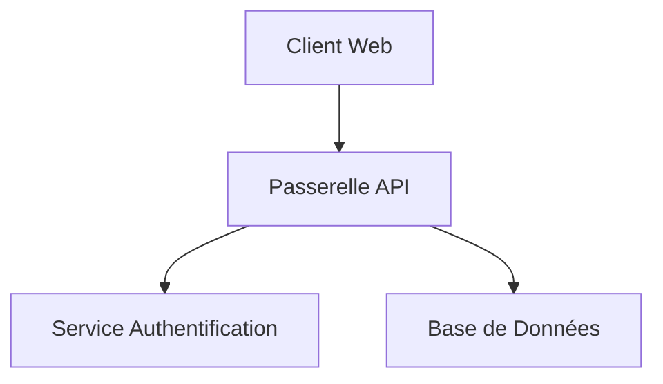

# Guide Complet des Balisages Markdown dans md2print

Ce guide référence l'ensemble des balises et syntaxes Markdown supportées par md2print pour la génération de documents Word (.docx), de présentations PowerPoint (.pptx) et d'aperçus HTML autonomes (visions Rapport et Slide 16:9).

---

## 1. Structure Documentaire et Découpage des Diapositives

En vision Diaporama (Slide) et lors de l'export PowerPoint, le découpage en diapositives suit cinq règles unifiées :

| Balise / Niveau | Rôle et Comportement | Exemple |
| :--- | :--- | :--- |
| `# Titre` | Diapositive de couverture (type Titre). Les lignes de texte situées immédiatement sous le titre font office de sous-titre, auteur ou date. | `# Stratégie de Sécurité 2026`<br>`Direction des Systèmes d'Information` |
| `## Titre` | Diapositive d'inter-titre ou de Chapitre. | `## 01. Contexte Réglementaire` |
| `### Titre` | Diapositive de contenu standard. Le titre s'affiche dans le bandeau supérieur de la diapositive. | `### Analyse des Risques NIS2` |
| `####` à `######` | Sous-titres hiérarchiques intégrés dans le corps de la diapositive courante (ne provoquent aucun saut de page/slide). | `#### Périmètre des Actifs Critiques` |
| `---` | Séparateur horizontal forçant la création d'une nouvelle diapositive de contenu tout en conservant le titre du dernier `###` qui précède. | `---` |

---

## 2. Disposition en Colonnes Multiples (Côte à Côte)

Permet d'afficher plusieurs blocs de contenu côte à côte. Les colonnes se partagent équitablement toute la largeur disponible de la diapositive ou de la page.

### 2.1. Syntaxe Standard (Recommandée)
```markdown
[colonne]
#### Colonne Gauche
- Point d'étape 1
- Point d'étape 2
[/colonne]

[colonne]
#### Colonne Droite
- Point d'étape 3
- Point d'étape 4
[/colonne]
```

### 2.2. Alias Court
```markdown
[col]
Contenu colonne 1
[/col]

[col]
Contenu colonne 2
[/col]
```

### 2.3. Paramétrage Étendu : `[colonne:taille relative:titre:couleur:ratio police]`
Les 4 paramètres après `colonne` sont optionnels :
- **`taille relative`** : ratio numérique (défaut : `1`) pour répartir la largeur disponible entre colonnes adjacentes.
- **`titre`** : titre affiché centré en haut de la colonne comme un titre de niveau 4 (`####`).
- **`couleur`** : typologie issue des badges/tags (`info`, `success`, `warning`, `danger`, `important`, `neutral`). Applique la couleur de bordure du tag correspondant en arrière-plan du bandeau de titre avec un texte blanc. Sans couleur précisée, le fond et le texte reprennent les réglages standards de la colonne.
- **`ratio police`** : multiplicateur numérique optionnel (ex. `0.85`, `1.2` ou `85%`, défaut : `1`) qui met proportionnellement à l'échelle la taille de police du titre et du corps de texte à l'intérieur de la colonne.

```markdown
[colonne:2:Points Clés:info]
Contenu large occupant les deux tiers de la largeur disponible, avec bandeau bleu Info.
[/colonne]

[colonne:1:Vigilance:warning:0.85]
Contenu étroit occupant un tiers de la largeur disponible, avec bandeau Warning et texte/titre réduits à 85 %.
[/colonne]

[colonne::Analyse Standard]
Colonne de ratio 1 par défaut avec titre centré sur fond standard.
[/colonne]

[colonne::::1.15]
Colonne sans titre dont le texte et les sous-titres internes sont agrandis de 15 %.
[/colonne]
```

### 2.4. Options Complémentaires
- **Conteneur global explicite** : `[colonnes]` ... `[/colonnes]` ou `[cols]` ... `[/cols]`.
- **Syntaxe bloc alternative** : `:::colonne` ... `:::` ou `:::col` ... `:::`.
- **Contenus acceptés dans une colonne** : texte, listes, KPI, badges, images, tableaux et schémas Mermaid.
- **Export PPTX / DOCX** : Les balises structurelles de colonnes sont automatiquement ignorées pour ne laisser aucun texte résiduel dans les fichiers exportés.

---

## 3. Cartouches Métriques et Indicateurs Clés (KPI)

Les cartouches de données agrandies permettent de mettre en valeur des indicateurs de performance, chiffres et pourcentages clés. Deux balises ou plus consécutives sur une même ligne s'agencent automatiquement en rangée horizontale partagée.

- **Syntaxe standard** : `[chiffre:valeur:libellé:variante]`
- **Alias supportés** : `[kpi:...]`, `[metric:...]`, `[stat:...]`

| Variante | Couleur d'accentuation | Exemple |
| :--- | :--- | :--- |
| `info` (défaut) | Bleu corporatif | `[chiffre:14.8M€:Chiffre d'Affaires]` |
| `success` | Vert de conformité | `[chiffre:99.98%:Disponibilité Système:success]` |
| `warning` | Orange d'alerte | `[chiffre:12:Incidents Majeurs:warning]` |
| `danger` | Rouge critique | `[chiffre:4min:Temps de Coupure:danger]` |
| `important` | Violet / Cyan | `[chiffre:85%:Objectif Atteint:important]` |
| `neutral` | Gris sobre | `[chiffre:42:Serveurs Audités:neutral]` |

*Remarque : Les alias de variantes en français sont également acceptés (`vert`, `rouge`, `orange`, `bleu`, `gris`, `ok`, `critique`).*

---

## 4. Badges et Étiquettes Inline

Étiquettes textuelles compactes à insérer directement dans un paragraphe, une liste ou un titre :

- **Syntaxe standard** : `[badge:type:texte]`

| Type de badge | Description | Exemple |
| :--- | :--- | :--- |
| `info` | Information générale | `[badge:info:Version 2.4]` |
| `success` | Validation / Statut positif | `[badge:success:Conforme]` |
| `warning` | Avertissement / Attention requise | `[badge:warning:En cours de révision]` |
| `danger` | Erreur / Risque majeur | `[badge:danger:Non Conforme]` |
| `important` | Élément prioritaire | `[badge:important:Priorité 1]` |
| `neutral` | Neutre / Gris | `[badge:neutral:Optionnel]` |

*Alias acceptés : `note`, `tip`, `astuce`, `ok`, `valide`, `warn`, `caution`, `critique`, `error`.*

---

## 5. Alertes et Callouts (Encadrés d'Avis)

Encadrés préformatés avec liseré coloré pour structurer les notes, avertissements et points d'attention :

```markdown
> [!NOTE]
> Information complémentaire pour le lecteur.

> [!TIP]
> Astuce pour accélérer la configuration du service.

> [!IMPORTANT]
> Étape obligatoire avant la mise en production.

> [!WARNING]
> Attention aux coupures de service programmées.

> [!CAUTION]
> Action irréversible susceptible d'entraîner une perte de données.
```

Il est également possible de personnaliser le libellé du titre :
```markdown
> [!WARNING] Mesures Préventives
> Sauvegarder la base de données avant toute intervention.
```

---

## 6. Typographie et Enrichissement Textuel

| Style | Syntaxe Markdown | Exemple |
| :--- | :--- | :--- |
| Gras | `**texte**` | `**Paramètre obligatoire**` |
| Italique | `*texte*` ou `_texte_` | `*Mention légale*` |
| Gras et italique | `***texte***` | `***Information essentielle***` |
| Souligné | `__texte__` ou `<u>texte</u>` | `__Terme contractuel__` |
| Barré | `~~texte~~` | `~~Ancienne version~~` |
| Code inline | `` `code` `` | `` `const port = 8080;` `` |
| Lien hypertexte | `[libellé](url)` | `[Portail ANSSI](https://cyber.gouv.fr)` |

---

## 7. Listes et Checklists

### 7.1. Listes à Puces et Sous-Listes
```markdown
- Serveur d'application
  - Nginx en reverse proxy
  - Node.js runtime
- Base de données PostgreSQL
```

### 7.2. Listes Numérotées
```markdown
1. Diagnostic initial
2. Déploiement des correctifs
3. Validation et audit de recette
```

### 7.3. Checklists (Cases à Cocher)
```markdown
- [x] Audit des accès administrateurs validé
- [ ] Revue des certificats TLS en attente
```

---

## 8. Schémas et Diagrammes Vectoriels Mermaid

md2print intègre nativement Mermaid.js pour la génération de diagrammes vectoriels qui s'adaptent automatiquement à la largeur et à la hauteur de la diapositive ou de la colonne :

````markdown

````

Types de diagrammes Mermaid supportés :
- Diagrammes de flux : `graph TD`, `graph LR`, `flowchart TD`
- Diagrammes de séquence : `sequenceDiagram`
- Diagrammes de classes : `classDiagram`
- Diagrammes d'état : `stateDiagram-v2`
- Diagrammes Entité-Relation : `erDiagram`
- Diagrammes circulaires : `pie`
- Diagrammes de Gantt : `gantt`
- Historiques de branches Git : `gitGraph`

---

## 9. Blocs de Code avec Coloration Syntaxique

````markdown
```javascript
function calculerTotal(articles) {
  return articles.reduce((acc, item) => acc + item.prix, 0);
}
```
````

Langages courants pris en charge : `javascript`, `typescript`, `python`, `bash`, `json`, `sql`, `html`, `css`, `yaml`.

---

## 10. Tableaux

Les tableaux Markdown GFM sont automatiquement mis en forme avec un en-tête coloré, une alternance de fond pour les lignes paires, et un conteneur responsive à défilement horizontal si nécessaire :

```markdown
| Composant | Rôle | Statut |
| :--- | :--- | :--- |
| Passerelle | Routage | [badge:success:Actif] |
| Base principale | Stockage | [badge:success:Actif] |
| Réplica | Sauvegarde | [badge:warning:Synchro] |
```

---

## 11. Images et Illustrations

Les images s'adaptent proportionnellement au cadre 16:9 de la diapositive ou à la colonne sans déformation ni débordement :

```markdown

```

Sources prises en charge :
- Chemins relatifs vers des images du projet.
- Images glissées-déposées dans l'éditeur (stockées en Base64).
- URL web distantes (`https://...`).

---

## 12. Citations Textuelles Simples

```markdown
> La simplicité est la sophistication suprême.
```

---

## 13. Frises Chronologiques et Jalons de Processus ([frise] ... [/frise])

Permet de représenter une chaîne de jalons ou une frise chronologique horizontale sous forme de pastilles circulaires reliées par une ligne continue, avec titres et descriptions explicatives parfaitement centrés.

### 13.1. Syntaxe Standard (Recommandée avec séparateur `|`)

```markdown
[frise]
- **T0** | **Détection** | Alerte de nos équipes, d'un prestataire ou d'un métier
- **Q** | **Qualification** | L'incident est-il majeur ? Assurés touchés, durée, données
- **4 h** (danger) | **Alerte au superviseur** | L'ACPR est prévenue, au plus tard 24 h après la découverte
- **72 h** (warning) | **Point d'étape** | Causes, impacts, mesures de remise en route
- **30 j** | **Rapport final** | Cause réelle, enseignements, actions correctives
[/frise]
```

### 13.2. Variantes de Couleurs des Jalons
La couleur de chaque pastille peut être précisée entre parenthèses juste après le jalon :
- `(danger)` ou `(rouge)` : Rouge alerte / incident critique
- `(warning)` ou `(orange)` : Orange avertissement / attention
- `(success)` ou `(vert)` : Vert validation / achèvement
- `(info)` ou `(bleu)` : Bleu secondaire
- `(purple)` ou `(violet)` : Pourpre
- `(muted)` ou `(gris)` : Gris neutre
- *(Par défaut sans parenthèse)* : Bleu nuit corporate principal

### 13.3. Syntaxe Alternative
Les alias suivants sont également pris en charge :
- `[timeline] ... [/timeline]`
- `:::frise ... :::`
- Séparateur deux-points ` : ` au lieu du tube `|` :
  `- **T0** : **Détection** : Alerte de nos équipes...`

---

## 14. Composants HTML / CSS / JS Exécutables ([html] ... [/html] ou ```html-exec)

Permet d'intégrer des widgets interactifs, animations CSS/SVG ou scripts JavaScript directement dans le rendu HTML (aperçu en direct, mode Rapport, mode Diaporama 16:9 et export `.html` autonome). Dans l'éditeur Markdown non-WYSIWYG, le bloc est automatiquement condensé en une cartouche `[html]` pliable, dépliable et déplaçable à la souris (à l'identique de la cartouche `[mermaid]`), ce qui protège les lignes vides, les sélecteurs CSS `#id` et le code JavaScript contre toute interprétation Markdown parasite.

### 14.1. Syntaxes Reconnues

**Syntaxe balisée courte :**
```markdown
[html]
<div id="demo-box" style="padding: 16px; border: 1px solid #cbd5e1; border-radius: 8px;">
  <button id="demo-btn" type="button">Tester l'interaction</button>
</div>
<script>
  document.getElementById('demo-btn')?.addEventListener('click', (e) => {
    e.currentTarget.textContent = 'Action exécutée';
  });
</script>
[/html]
```

**Syntaxe bloc de code exécutable (canonique à la sauvegarde) :**
````markdown
```html-exec
<style>
  #mon-widget { padding: 16px; border-radius: 8px; }
</style>
<div id="mon-widget">Contenu interactif</div>
```
````

- **Alias supportés** : `:::html ... :::`, ```` ```html-live ````, ```` ```html-run ````, ```` ```html-widget ````.
- **Raccourci clavier dans l'éditeur** : `Ctrl+Shift+H` ou `Alt+H` insère directement une cartouche `[html]` ouverte à la position du curseur.


