# Exemples de schémas Mermaid pris en charge

Ce document rassemble des exemples concrets pour chaque famille de diagrammes Mermaid supportée par md2print, que ce soit pour la prévisualisation dans l'éditeur, l'export HTML autonome, Word (.docx) ou PowerPoint (.pptx).

---

## 1. Histogramme et Courbe combinés (xychart-beta)

Ce graphique bénéficie du nouveau moteur de rendu vectoriel : cartouches arrondis, fond avec grille de points, courbe de Bézier lissée avec halo lumineux et légende intégrée.

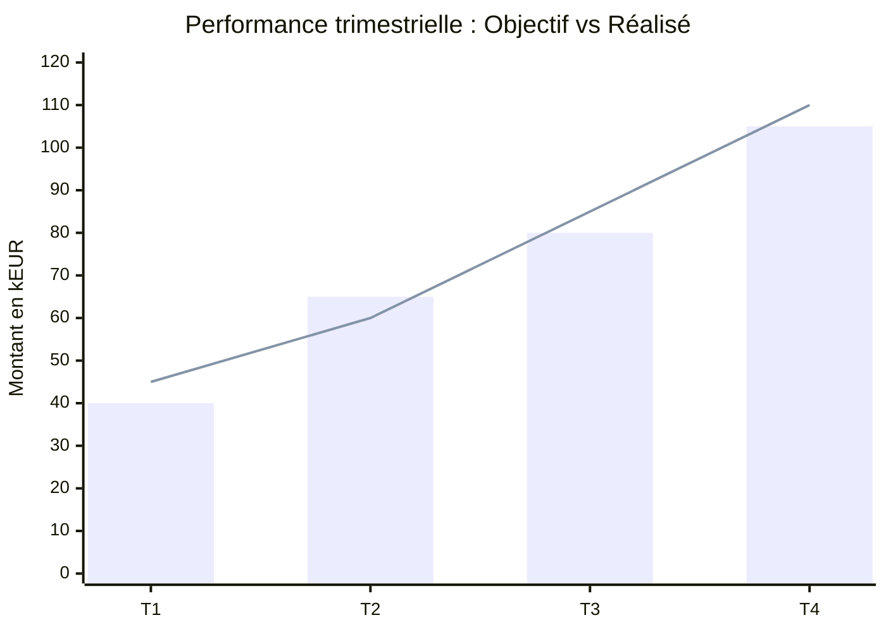

---

## 2. Histogramme multi-séries horizontales (xychart-beta horizontal)

Les séries de barres multiples sont automatiquement positionnées côte à côte (groupées) et adaptées aux couleurs du thème actif.

```mermaid
xychart-beta horizontal
    title "Comparatif des ventes régionales"
    x-axis ["Nord", "Sud", "Est", "Ouest"]
    y-axis "Taux d'atteinte (%)" 0 --> 100
    bar [75, 60, 85, 90]
    bar [80, 70, 65, 95]
```

---

## 3. Diagramme de flux de processus (Flowchart)

Idéal pour cartographier les processus décisionnels, les logiques métier et les parcours de validation.

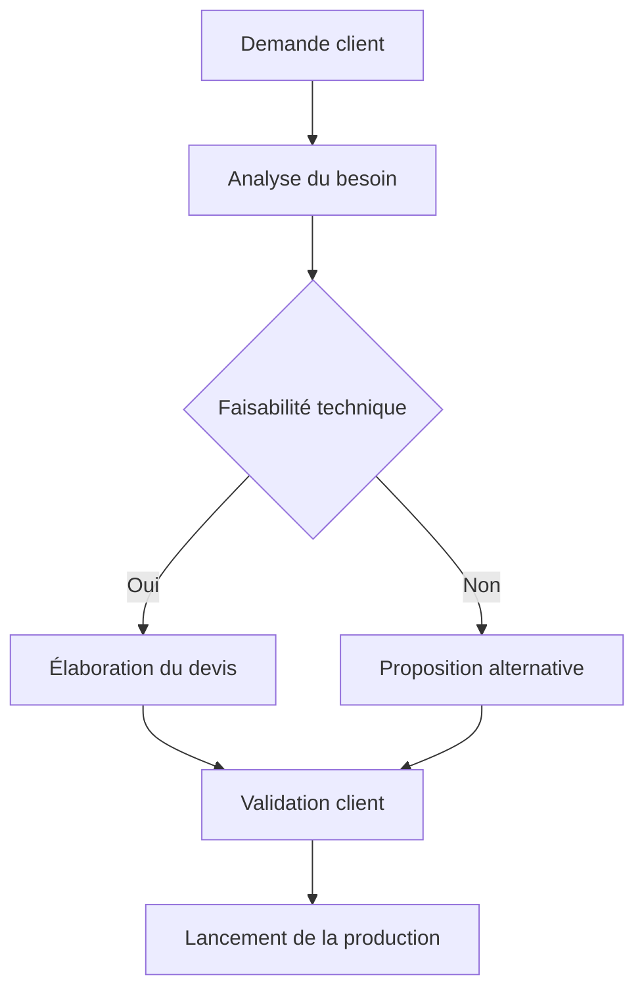

---

## 4. Diagramme de séquence (Sequence Diagram)

Permet de décrire les interactions chronologiques et les flux d'appels entre différents systèmes ou acteurs.

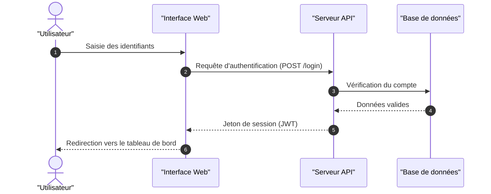

---

## 5. Diagramme circulaire (Pie Chart)

Utile pour illustrer la répartition proportionnelle d'un ensemble de catégories ou de budgets.

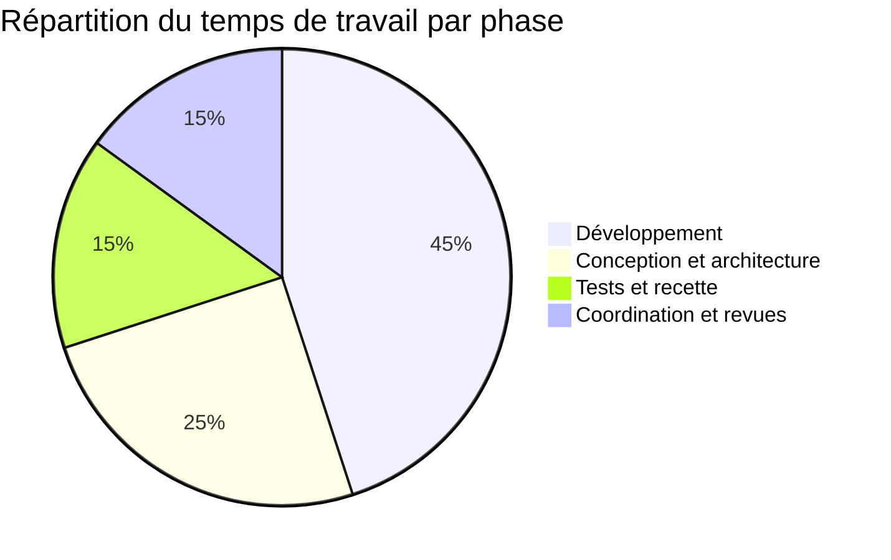

---

## 6. Diagramme de Gantt (Planning de projet)

Permet de suivre le calendrier d'un projet avec ses jalons, ses dépendances et l'état d'avancement des tâches.

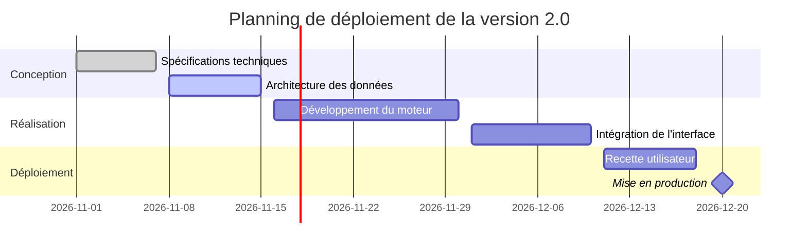

---

## 7. Diagramme d'états (State Diagram)

Modélise le cycle de vie d'un objet métier ou d'un document au sein du système.

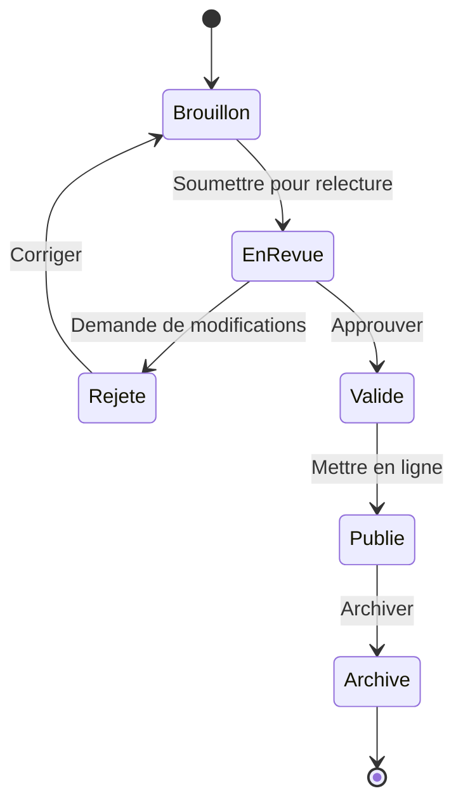

---

## 8. Diagramme de classes UML (Class Diagram)

Présente la structure orientée objet, les attributs, méthodes et relations d'héritage ou d'association.

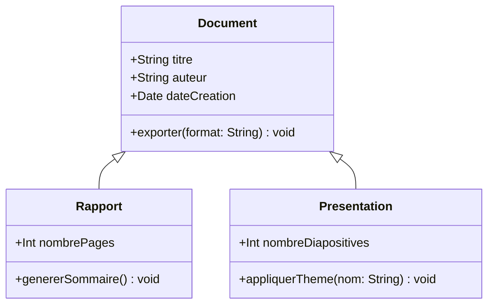

---

## 9. Diagramme Entité-Relation (ER Diagram)

Définit le schéma d'une base de données relationnelle et les cardinalités entre tables.

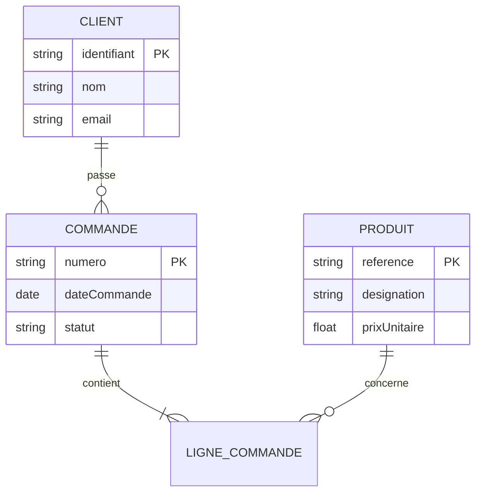

---

## 10. Matrice de positionnement stratégique (Quadrant Chart)

Permet d'évaluer et de prioriser des éléments selon deux axes (effort/valeur, risque/rentabilité, etc.).

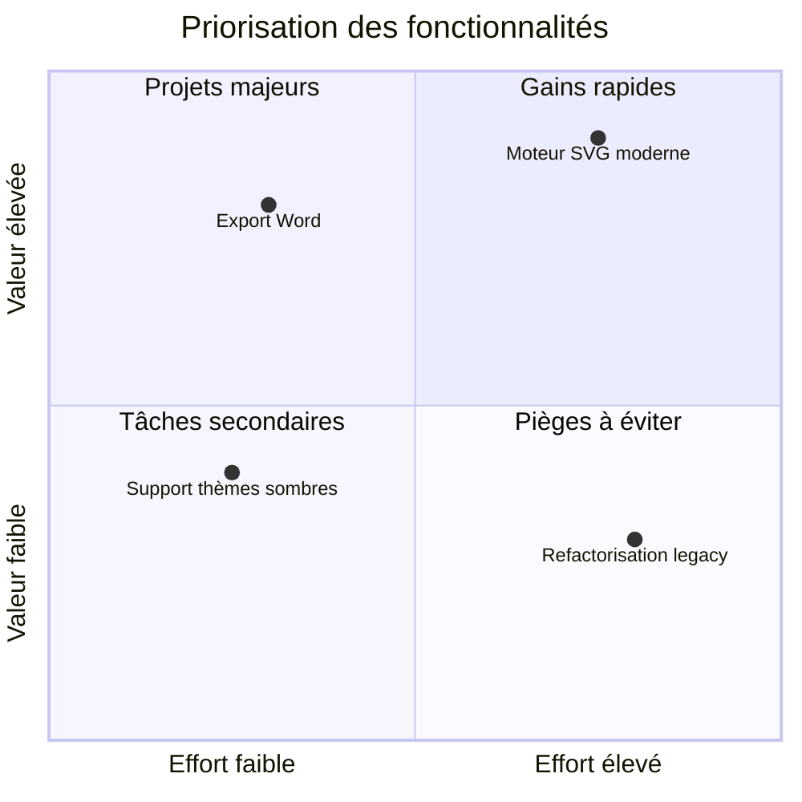

---

## 11. Carte mentale (Mindmap)

Structure visuellement des concepts, des arborescences de fonctionnalités ou des sessions de remue-méninges.

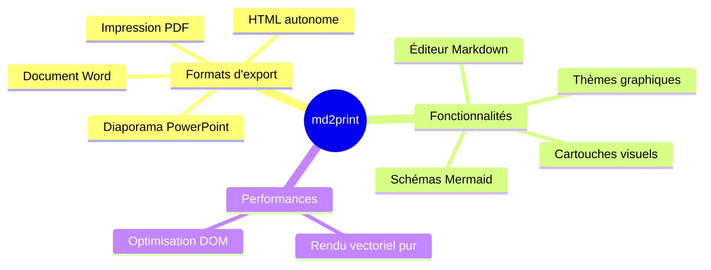

---

## 12. Parcours utilisateur (User Journey)

Permet de cartographier l'expérience vécue par l'utilisateur étape par étape avec son niveau de satisfaction.

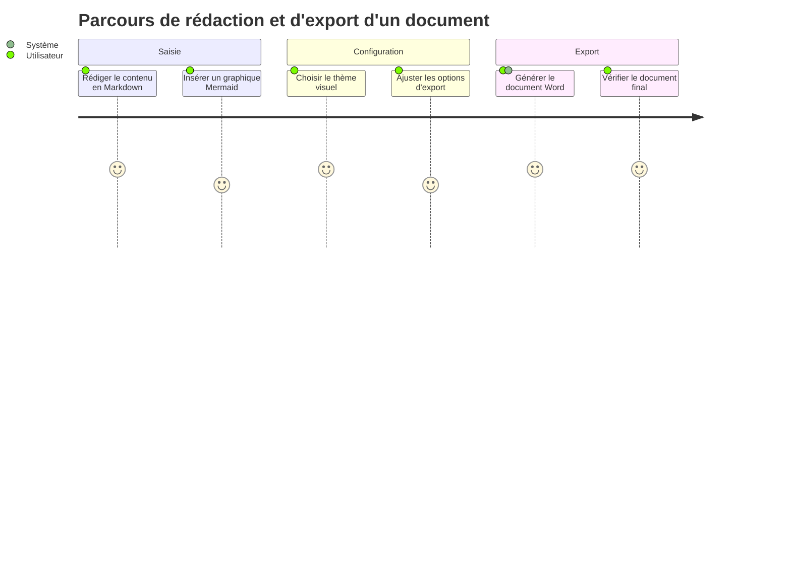

---

## 13. Historique de branches (GitGraph)

Illustre les flux de gestion de versions Git, la création de branches, les fusions et les versions taguées.

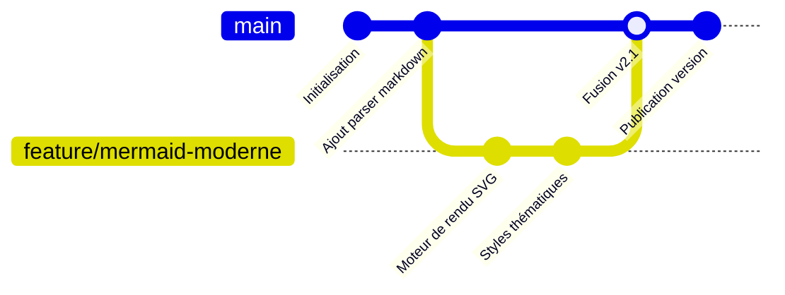

